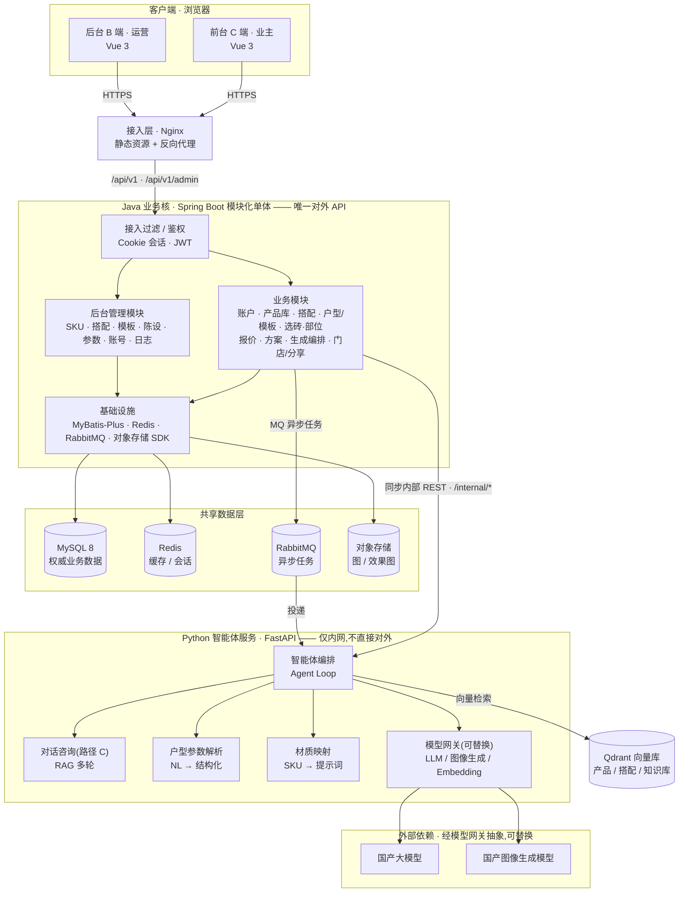

# 瓷砖选购 AI 效果图与报价系统

一套打通**「选砖 → 录户型 → AI 生成铺贴效果图 → 自动出报价单」**的全链路系统。
面向瓷砖门店,分两端:

- **C 端**(业主):浏览产品 → 选砖与部位 → 录户型 → 生成效果图 → 查看报价 → 分享给家人
- **B 端**(门店运营):产品库、搭配方案、户型模板、陈设、报价参数、账号与操作日志

---

## 一、系统架构

采用**分层 + 双后端**架构:Java 业务核负责确定性业务,Python 服务承担 AI 能力,
两者职责边界清晰,通过内部 REST 与消息队列通信。



**一句话概括**:前台/后台只连 Java;Java 是业务的唯一权威与对外入口;
Python 作为「AI 副驾」被动接收 Java 派发的编排/生成任务,经模型网关调用国产模型,
再把结果回吐给 Java。

### 三层职责

| 层 | 职责 | 对外暴露 |
| --- | --- | --- |
| **客户端** | C 端与 B 端两个外壳,同一个 Vue 工程;仅消费 `/api/v1` 与 `/api/v1/admin` | — |
| **Java 业务核** | 账户鉴权、产品库、搭配、户型、选砖、**报价计算**、方案、生成编排、门店与分享;全部确定性业务逻辑 | 对外唯一 API |
| **Python 智能体** | 智能体编排、对话咨询(带 RAG 多轮)、自然语言户型解析、材质映射、模型网关 | 仅内网,网关阻断 `/internal/*` |
| **数据层** | MySQL 存权威业务数据;Redis 会话与缓存;RabbitMQ 异步任务;Qdrant 向量索引;对象存储放图 | — |

### 几条结构性约束

这几条是架构本身的一部分,决定了代码该往哪儿写:

- **Java 是唯一对外 API**。前端只连 Java,`/internal/*` 路径不出现在对外契约里。
- **Python 服务仅内网**。它不直接面向客户端,也不持有业务数据副本(向量索引除外)。
- **Qdrant 是派生索引**,随时可由 MySQL 全量重建,不参与业务事务,因此不是权威存储。
- **模型全部经模型网关抽象**。LLM / 图像生成 / Embedding 三类各自一个网关,
  厂商差异收敛在适配器里,切换只改配置,业务代码不动。

---

## 二、技术栈

| 层 | 选型 |
| --- | --- |
| 前端 | Vue 3(组合式 API)+ TypeScript + Vite + Pinia + Vue Router |
| 前端 UI | Ant Design Vue(全站接入主题令牌,支持 C / B 双主题) |
| 业务后端 | Java 17 + Spring Boot 3.5 + Spring Security + MyBatis-Plus |
| 数据库迁移 | Flyway(版本化迁移,`V*.sql` 只追加不回改) |
| 智能体 | Python 3.11+ / FastAPI + Uvicorn |
| 向量检索 | Qdrant(产品语义检索、搭配检索、知识库 RAG) |
| 缓存 | Redis(会话、令牌黑名单、限流令牌桶、热点缓存) |
| 消息队列 | RabbitMQ(异步生成任务、索引同步、成功回调) |
| 对象存储 | 阿里云 OSS / MinIO |
| 模型网关 | 自研抽象层,屏蔽厂商差异,配置化切换 |
| 部署 | Docker Compose(一期)→ Kubernetes(扩展期);Nginx 作入口 |

---

## 三、模块划分

### Java 业务核 — 模块化单体,按业务域分 15 个模块

一期同进程、以 package 划模块,后续可独立拆分为服务。

| 模块 | 职责 |
| --- | --- |
| `auth` | 注册、登录、JWT 签发与刷新、改密、退出;密码 BCrypt 加密 |
| `product` | SKU 增删改查、上下架、按花色/材质/规格/风格/价格筛选与搜索 |
| `combo` | 人工维护的成套搭配:空间/风格维度展示、SKU 清单与部位、参考报价区间 |
| `layout` | 户型模板维护;结构化户型的落库与校验(解析在 Python) |
| `selection` | 用户的选砖与部位选择 |
| `quote` | 报价计算引擎与报价参数 |
| `plan` | 方案管理:快照、重算、分享 |
| `generate` | 效果图生成编排与结果回传 |
| `store` | 门店与分享链接 |
| `furnish` | 陈设 |
| `admin` | 后台管理聚合:SKU、搭配、模板、陈设、参数、账号、操作日志 |
| `agent` | 对接 Python 智能体:会话、SSE 流式转发 |
| `index` | 索引同步(与 Python 侧的向量索引对接) |
| `internal` | 内部接口(`/internal/*`,仅内网可达) |
| `common` | 公共设施:统一响应体、错误码、鉴权、加密、Outbox、MQ 拓扑 |

### Python 智能体 — 按能力分包

| 包 | 职责 |
| --- | --- |
| `gateway` | 模型网关:LLM / 图像 / Embedding 三类适配器 + 故障切换 + 限流 |
| `chat` | 对话咨询:RAG 多轮、话题边界、会话存储、SSE 流式 |
| `agent` | 智能体编排、提示词、白模底图生成 |
| `generate` | 生成任务消费端与编排 |
| `index` | 向量索引:嵌入、集合定义、检索、索引同步消费端 |
| `api` / `clients` | 内部接口与对 Java 的客户端 |

### 前端 — 单工程双外壳

`tile-ai-web` 一个 Vue 工程里同时承载 C 端与 B 端,在 `layouts` 层分外壳,
`views` 下按域组织,共 27 个页面视图;`api` 层按 `c` / `admin` 分目录。

---

## 四、接口契约

**契约是唯一事实来源** —— 接口先写进 OpenAPI / AsyncAPI,再写实现;
契约与实现之间有可执行的比对,不靠人眼对。

| 文件 | 内容 |
| --- | --- |
| `openapi-common.yaml` | 公共组件:响应体、错误码、安全方案(仅 components,无 paths) |
| `openapi-c.yaml` | C 端接口 `/api/v1` |
| `openapi-admin.yaml` | B 端接口 `/api/v1/admin` |
| `openapi-internal.yaml` | 内部接口 `/internal`(Java ↔ Python) |
| `asyncapi-internal.yaml` | MQ 消息体与投递语义 |

改接口的顺序是**自上而下**的,不跳步、不反向改:

```
PRD → 架构 → 契约 YAML → 追溯记录
```

**校验不是靠自觉。** 仓库里有 7 道契约门禁(结构、lint、YAML 缺陷、
描述完整性、语义一致性、AsyncAPI),外加一个**契约 ↔ 实现双向比对**:
逐条比路径、方法、字段名、类型、必填、枚举取值,分叉即判红并阻断 CI。
比对清单本身也入库可查 —— 「跳过」与「一致」在报告里是两回事。

---

## 五、目录结构

```
.
├── CLAUDE.md                    ★ 文档索引与项目铁律(工程约定的唯一入口)
├── README.md
│
├── tile-ai-prd.md               需求(文档链源头)
├── tile-ai-architecture.md      架构
├── openapi-*.yaml               接口契约(4 份)
├── asyncapi-internal.yaml       MQ 契约
├── openapi-verification.md      契约 ↔ 实现追溯表 + 全部决策记录
├── tile-ai-tasks.md             任务卡片
├── tile-ai-roadmap.md           进度与验收基线
├── tile-ai-design.md            前端视觉规范
├── tile-ai-frontend-stack.md    前端选型与依赖闸门
├── tile-ai-frontend-structure.md 前端目录与依赖方向
├── tile-ai-style-foundation.md  令牌机制与主题
├── tile-ai-ui-rollout-plan.md   UI 改造实施计划
│
├── tile-ai-server/              Java 业务核
│   └── src/main/resources/db/migration/   Flyway 版本化迁移
├── tile-ai-agent/               Python 智能体服务
├── tile-ai-web/                 Vue 3 前端(C 端 + B 端)
│
├── deploy/                      本地中间件编排
├── outputs/scripts/             契约门禁与校验脚本
├── tools/                       运维与审计脚本
├── .githooks/                   提交前钩子
└── .github/workflows/           CI
```

---

## 六、本地运行

### 0. 中间件

```powershell
docker compose -f deploy/docker-compose.dev.yml up -d     # Redis / Qdrant / RabbitMQ
```

MySQL 走本机原生安装,不在 compose 内。

### 1. Java 业务核(8080)

```powershell
cd tile-ai-server
mvn spring-boot:run "-Dspring-boot.run.profiles=local"
```

需提供 `DB_PASSWORD` 与 `LAYOUT_ENC_KEY`(后者用于户型数据静态加密)。

### 2. Python 智能体(8000)

```powershell
cd tile-ai-agent
python -m uvicorn app.main:app --port 8000
```

### 3. 前端(5173)

```powershell
cd tile-ai-web
npm install
npm run dev
```

---

## 七、测试与校验

五类判据,全过才算完。

| # | 对象 | 命令 |
| --- | --- | --- |
| 1 | 契约门禁(7 道) | `bash outputs/scripts/ci.sh` |
| 2 | 契约 ↔ 实现比对 | `bash outputs/scripts/contract-diff.sh`(需在 1 之前跑,门禁会读它的产物) |
| 3 | Java | `mvn test -Ddb.verify=true -Dredis.verify=true -Drabbit.verify=true` |
| 4 | Python | 先 `cd tile-ai-agent`,再 `pytest -q`(必须在 `tile-ai-agent` 目录下跑) |
| 5 | 前端 | 先 `cd tile-ai-web`,再 `npm test`;`npm run build` 内含 `vue-tsc` 类型检查 |

需要外部依赖的测试由**显式开关**控制 —— 不带开关时集成测试会整批跳过,
所以「跳过」不等于「通过」。测试连的是隔离出来的测试库
(独立 schema / 独立 Redis 库号 / 独立 MQ vhost),不碰开发数据。

---

## 八、项目边界

一期明确不做:线上下单与支付、铺贴人工费、物流费、美缝、上传户型图识别、
第三方登录、多空间/全屋出图、效果图陈设计入报价。

完整边界见 `tile-ai-prd.md` §10 / §12。
