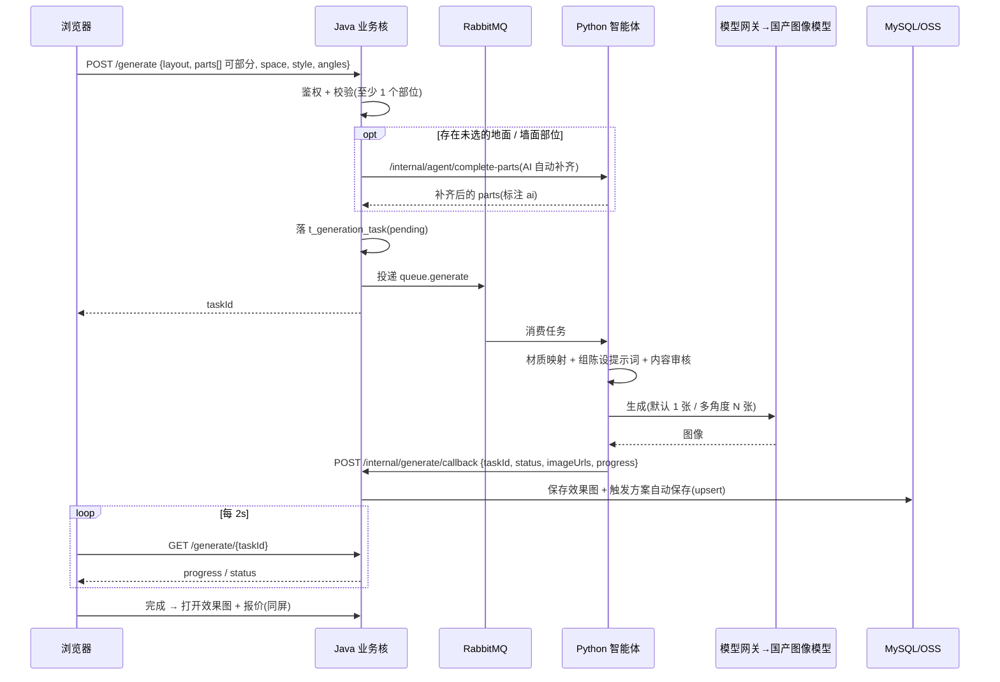
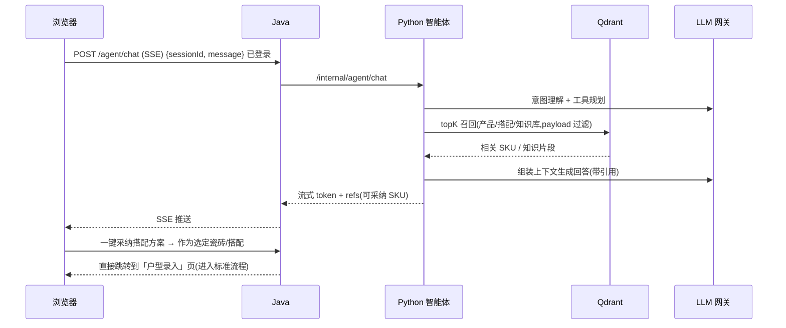
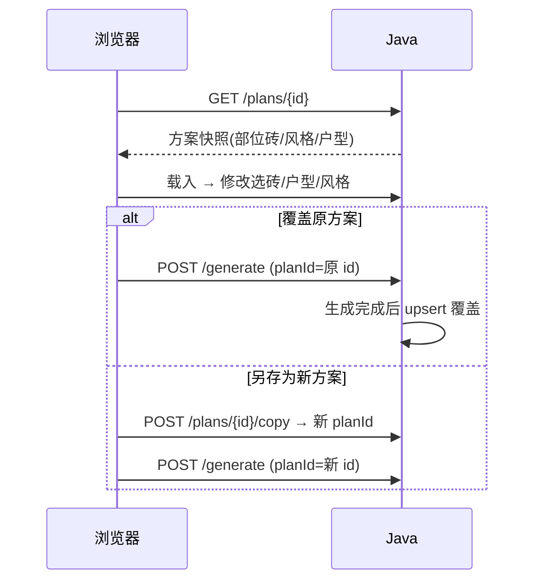

# 瓷砖选购 AI 效果图与报价系统 — 架构设计文档

## 文档信息

| 项目 | 内容 |
| --- | --- |
| 文档名称 | 瓷砖选购 AI 效果图与报价系统 架构设计文档 |
| 版本 | v2.4 |
| 编写日期 | 2026-09-27 |
| 状态 | 已确认 |
| 上游文档 | tile-ai-prd.md(需求文档 v0.6,需求定稿) |
| 适用范围 | 阶段 0(后台)与一期(MVP)的架构设计;二期/三期为演进方向 |

**文档关系**:本文件为需求文档(tile-ai-prd.md v0.6)的架构落地设计,所有功能点以 PRD 为准,不重复描述业务规则,仅说明"如何实现"。若二者冲突,以 PRD 为准。

**修订记录**:

| 版本 | 日期 | 变更 |
| --- | --- | --- |
| v1.2 | 2026-09-27 | 基线(已确认版) |
| v1.3 | 2026-09-29 | ① §15.9 裁决 MQ 选型:一期采用 **RabbitMQ**(P0-3①);② §13.5 补充 **CSRF / SameSite** 防护;③ §8.7 补 **`t_import_batch`** 表定义(闭合缺口 G-2)。三项均**不改变既有接口语义**,不涉及字段增删 |
| v1.4 | 2026-09-29 | §4.4 新增**「权限点 → 角色」对照表**(22 个权限点),并据此明确三处此前含糊的边界:报价参数仅 super_admin、`product:import` 仅 operator、字典读写归属。改动**只澄清既有意图**,不新增权限点 |
| v1.5 | 2026-09-29 | §8.3 补 **`areas` 面积推导公式**(floor = 长×宽;wall = 2×(长+宽)×层高;local = 0),并关闭契约中 `LayoutSpace.areas` 的 `x-todo`。同时**标注**该示例值与新公式不一致(13.9 vs 20.52)但**保留原值**——理由见 §8.3 的说明 |
| v1.6 | 2026-09-29 | §8.5 为 `t_quote_param` 增 **`loss_rate`** 参数键(当前采用的损耗率),原 `loss_rate_min/max` 明确为**允许范围**;§8.8 补「参数来源」表,并明确**地面开口扣减等价于 0**(户型模型无墙厚字段,与 §10.6⑤ 示例一致) |
| v1.7 | 2026-09-29 | **登录方式由「手机号 + 短信验证码」改为「用户名 + 密码」**(随 PRD v0.7)。改动 §2/§3 的 Redis 用途、§4.1 auth 职责、§8.1(`t_user.phone` → `username`,删除 `t_sms_code`)、§10.1(取消 `tempToken` 例外)、§10.2(4 个 auth 接口 → 2 个)、§10.5(移除 20001/20002,20003 改义)、§11.1 时序图、§13.6/§13.7、§15.6(整节标记为已取消,保留决策记录)、§15.8。**不涉及任何业务模块** |
| v1.8 | 2026-09-29 | **模型选型落定**(随 PRD v0.8):§15.1 由"建议 bake-off 后定"改为**已定** —— 主力 `deepseek-flash` + 备份 智谱 GLM,图像 `wan2.7-image-pro`,Embedding 仍待定;§15.3 的"先后两期"分期**作废**,一期直接以多参考图条件生成作为生产路径;§7.2 标注已选实现。**不改变任何接口语义**,契约无需同步 |
| v1.9 | 2026-09-29 | **补后台会话接口**(随 PRD v0.9):§10.3 由"后台登录:`POST /admin/auth/login`"一句,展开为**三个会话接口**(`login` / `logout` / `me`),并写明它们**不需要权限点**、登出沿用 C 端"需要登录态"的口径、以及为何需要 `GET /admin/auth/me`。**新增接口,不改变既有接口语义** |
| v2.0 | 2026-09-29 | **两端会话分离**(缺口 G-9):§10.1 由"一套 Cookie"改为 **C 端 / B 端各一套**(名字与路径都分开),并记明实测依据 —— 两端同名同路径会**互相覆盖**(先登 C 端再登后台 → C 端 403 掉线),且 `refresh_token` 的 Path 覆盖不到后台登录路径,**被浏览器直接丢弃**(后台因此无法刷新)。§10.3 补 `POST /admin/auth/refresh`。**Cookie 名与路径在契约中声明,故本次为契约变更** |
| v2.1 | 2026-09-29 | **图像协议纠正(实测)**:§7.2 原写"适配器统一走 OpenAI 兼容协议"—— 拿到密钥实测后确认**该结论对图像不成立**,`wan2.7-image-pro` 走 DashScope 原生协议(端点/请求体/响应结构全不同)。§7.2 增协议对照与教训;§15.1 补图像模型的实测结果(参考图上限 9、延迟 <60s、参考图吃视觉 token、出图是 24h 临时 URL、`n>1` 落在多个 choices)。**三类网关的抽象(§7.1)不变**,只纠适配器形态 |
| v2.2 | 2026-09-29 | **关闭 5 处 `x-todo`**(内部契约评审):§10.4 补**内部接口四条约定** —— ① 错误码与对外同一套、Java 只透传已定义码(其余折 90001);② SSE 流中途失败用 **`error` 事件**表达(与 `[DONE]` 互斥);③ 户型解析**不返回半成品**(失败 10001 + `data.errors[]`,`params` 优先于 `text`);④ 陈设缺失**降级不阻断**(空陈设 + WARN + `furnishConfigured: false`)。另:材质映射改为返回**结构化片段**,并把"该端点是否真被调用"留待 T-1.11 判定 |
| v2.3 | 2026-10-01 | **补 C 端会话接口 `GET /auth/me`**(随 PRD v0.10):§10.2 表增一行,并写明**为何 C 端也需要它** —— 理由与 §10.3 当初为后台写的相同(令牌在 HttpOnly Cookie 里,页面刷新后前端无法自行知道"当前是谁"),并明确它**不需要权限点**。**新增接口,不改变既有接口语义**。另:本文档头部「版本」行此前长期停留在 v1.7(记录已到 v2.2),本次一并回填 |
| v2.4 | 2026-10-02 | **Embedding 选型落地**(P0-2 的第一块):§15.1 由"**仍未定**,优先如 BGE-M3 自部署"改为**已定 —— `Qwen3-Embedding-0.6B` 本地进程内跑**(Apache 2.0,原生 1024 维,与 `index_vector_size` 一致),并写明**与原建议的差异及理由**(含 Ollama 那条路为何走不通:安装包只在 GitHub 分发);§15.1 一并记入两条**必须显式做**的事 —— 换模型必须**重建索引**(否则旧新向量混在同一集合里,检索是乱的),以及**重建工具与服务走同一个工厂**。§4.2 的适配器示例同步。**不改变任何接口语义**,契约与 PRD 无需同步 |

---

## 1. 架构目标与设计原则

### 1.1 架构目标

1. 支撑 PRD 的一期完整闭环:注册登录 → 三条选砖路径 → 户型录入 → 单空间 AI 效果图 → 按部位报价 → 方案自动保存/管理 → 引导线下。
2. **AI 能力与业务能力解耦**:LLM 编排、RAG、图像生成等不确定性强的能力收敛到独立的 Python 智能体服务;确定性业务(账户、产品库、报价、方案)由 Java 承担。
3. **模型可替换**:大模型与图像生成模型通过统一"模型网关"接入,厂商可插拔,不写死在业务代码里。
4. 面向单店、B2C、中小规模起步,**先简单后扩展**:一期采用"模块化单体 + 独立智能体服务",预留拆分能力,不做过早微服务化。

### 1.2 设计原则

- **单一职责、边界清晰**:确定性逻辑(报价、鉴权、CRUD)绝不交给 LLM;LLM 只做"理解与生成"。
- **前后端分离**:前端(Vue 3 应用)只与 Java 应用交互,不直连 Python 与第三方模型。
- **异步优先**:图像生成是长任务(≤60s),用消息队列 + 任务表 + 轮询/流式进度,避免同步阻塞。
- **数据权威单一**:业务数据以 MySQL 为准;向量库(Qdrant)为**可重建的派生索引**,不作为权威存储。
- **配置化**:报价参数(辅料单价、损耗率)、陈设风格提示词、门店信息均由后台配置,不写死。
- **安全内建**:鉴权、密码加密、敏感数据加密、内容安全审核贯穿设计。

---

## 2. 总体架构

系统采用**分层 + 双后端(Java 业务核 + Python 智能体)**架构。

```
┌─────────────────────────────────────────────────────────────────────┐
│                          客户端(浏览器)                              │
│   前台 C 端(业主)                │        后台 B 端(运营)            │
│   Vue 3 应用(响应式)                │        Vue 3 应用                  │
└───────────────┬───────────────────────────────┬─────────────────────┘
                │  HTTPS                        │  HTTPS
                ▼                               ▼
┌─────────────────────────────────────────────────────────────────────┐
│                    接入层  Nginx(静态资源 + 反向代理)               │
└───────────────┬───────────────────────────────┬─────────────────────┘
                │                               │
                ▼                               ▼
┌─────────────────────────────────────────────────────────────────────┐
│              Java 业务核(Spring Boot,模块化单体)—— 唯一对外 API     │
│                                                                       │
│  接入模块        业务模块                                               │
│  ┌─────────┐   ┌──────────┬──────────┬──────────┬───────────────┐  │
│  │ 鉴权/网关 │   │ 账户模块  │ 产品库模块│ 搭配模块  │ 户型/模板模块  │  │
│  │ JWT/过滤  │   ├──────────┼──────────┼──────────┼───────────────┤  │
│  └─────────┘   │ 选砖·部位 │ 报价模块  │ 方案模块  │ 门店/分享模块  │  │
│                ├──────────┴──────────┴──────────┴───────────────┤  │
│                │ 后台管理模块(SKU/搭配/模板/陈设/参数/账号/日志)  │  │
│                └──────────────────────────────────────────────────┘  │
│   基础设施:MyBatis-Plus · Redis · RabbitMQ · 对象存储 SDK             │
└───────┬──────────────────────────────────────┬──────────────────────┘
        │ 同步 REST(内部鉴权)                  │ MQ 异步任务 / 回调
        ▼                                      ▼
┌─────────────────────────────────────────────────────────────────────┐
│           Python 智能体服务(FastAPI)—— 仅内网,不直接对外            │
│   ┌───────────────┬───────────────┬───────────────┬──────────────┐  │
│   │ 智能体编排     │ 对话咨询(路径C)│ 户型参数解析   │ 材质映射       │  │
│   │ Agent Loop    │ RAG 多轮       │ NL → 结构化    │ SKU → 提示词   │  │
│   ├───────────────┼───────────────┼───────────────┼──────────────┤  │
│   │ 模型网关(可替换):LLM 网关 / 图像生成网关 / Embedding 网关        │  │
│   └───────────────┴───────────────┴───────────────┴──────────────┘  │
└───────┬──────────────────────────────────────────────────────────────┘
        │ 向量检索                        │ 调用第三方模型 API
        ▼                                 ▼
┌───────────────────┐          ┌──────────────────────────────┐
│  Qdrant 向量库     │          │  国产大模型 / 国产图像生成模型 │
│  产品/搭配/知识库   │          │  (经模型网关抽象,可替换)      │
└───────────────────┘          └──────────────────────────────┘

        共享数据层:MySQL 8(权威业务数据) · Redis(缓存/会话)
                   · RabbitMQ(异步任务) · 对象存储(图/效果图)
```

**一句话概括**:前台/后台只连 Java;Java 是业务的唯一权威与对外入口;Python 作为"AI 副驾"被动接收 Java 派发的编排/生成任务,通过模型网关调用国产模型,并把结果回吐给 Java。

---

## 3. 技术选型

| 层 | 选型 | 说明 |
| --- | --- | --- |
| 前端 | **Vue 3**(组合式 API)+ Pinia + Vue Router;可选 TypeScript | **优先采用框架开发**:组件化 + 状态管理 + 路由内置,提升可维护性与迭代效率;生态成熟、上手快,响应式适配 Chrome/Safari/Edge 与移动端浏览器。 |
| 前端构建 | **Vite**(开发服务器 + 构建打包)+ Nginx 托管构建产物 | 框架工程标配工具链,支持热更新与按需打包;构建产物静态托管,与一期单机部署一致。 |
| Java 运行时 | JDK 17(LTS) | 长期支持,生态成熟。 |
| Java 框架 | Spring Boot 3.x + Spring MVC + Spring Security | 模块化单体,按 package 划模块。 |
| Java ORM | MyBatis-Plus | 国内生态好、SQL 可控。 |
| Java 鉴权 | Spring Security + JWT(access + refresh) | 无状态鉴权,支持 C/B 端。 |
| Python 运行时 | Python 3.11+ | 智能体主流版本。 |
| Python 框架 | FastAPI + Uvicorn | 异步、类型友好、易做 SSE 流式。 |
| 智能体框架 | LangChain / LangGraph(或轻量自研编排) | Agent Loop、工具调用、RAG 编排。 |
| 传统数据库 | **MySQL 8** | 权威业务数据(用户/SKU/搭配/模板/方案/报价参数)。 |
| 向量数据库 | **Qdrant** | 产品语义检索、搭配检索、知识库 RAG;过滤能力强、部署轻。 |
| 缓存 | Redis 7 | 登录会话/refresh 黑名单、热点数据缓存、限流。 |
| 消息队列 | **RabbitMQ**(已裁决,见 §15.9) | 异步效果图生成任务、索引同步、生成回调解耦。 |
| 对象存储 | 阿里云 OSS / MinIO(自建) | 存 SKU 图、效果图、分享封面;MySQL 只存 URL。 |
| 模型网关 | 自研抽象层(LLM / Image / Embedding 三类网关) | 屏蔽厂商差异,配置化切换。 |
| 部署 | Docker Compose(一期)→ Kubernetes(扩展期) | 组件编排;Nginx 作入口。 |
| 可观测 | 日志(SLF4J + Logback / Python logging)+ 可选 Prometheus + Grafana | 监控生成耗时、成功率等成功指标。 |

> 选型可替换点已在表中标注;数据库(MySQL+Qdrant)与架构风格按评审确认结论选定。

---

## 4. 模块划分与职责

### 4.1 Java 业务核(模块化单体)

按业务域划分为以下模块(以 Spring Boot 的 package/模块组织,一期同进程,后续可独立成服务):

| 模块 | 职责 | 对应 PRD |
| --- | --- | --- |
| **auth / account 账户鉴权** | 用户名注册(唯一性校验)、密码登录、JWT 签发与刷新、修改密码、退出;密码 BCrypt 加密 | 5.1、7.7 |
| **product 产品库** | SKU 的增删改查、上下架、筛选(花色/材质/规格/风格/价格区间)、按名称/编号搜索、多角度图 | 5.2.1、7.1 |
| **combo 推荐搭配** | 人工维护的成套搭配:空间/风格维度展示、含 SKU 清单与各 SKU 部位、参考报价区间 | 5.2.2、7.2 |
| **layout 户型/模板** | 户型模板维护与筛选;接收"结构化户型数据模型";自然语言解析的**落库与校验**(解析本身在 Python) | 5.3、7.3 |
| **selection 选砖·部位映射** | 一个空间多砖、部位分配(地面/墙面/局部);空间—部位—瓷砖映射;支持**部分选择**(不强制选全) | 5.2.4、7.4 |
| **quote 报价计算** | 规则引擎:按部位计算材料费 + 辅料及损耗;**开口面积扣减**、**同部位同砖合并计算**;参数(辅料单价/损耗率)读取;生成报价明细(详见 §8.8) | 5.5 |
| **plan 方案** | 方案自动保存、我的方案管理(预览/重命名/删除/重新编辑/另存为)、方案快照、分享链接/二维码 | 5.6、7.5 |
| **generate 生成编排** | 效果图生成任务的受理、**未选地面/墙面部位的 AI 自动补齐触发**、任务落库、派发 MQ、进度查询、接收 Python 回调、结果落库与自动保存触发 | 5.4 |
| **store 门店/引导** | 单店地址与联系方式展示 | 5.6、7.6 |
| **admin 后台管理** | SKU(含**批量导入**)/搭配/户型模板/陈设风格/报价参数/门店/账号权限(**RBAC**)/操作日志的 B 端接口 | 5.7 |
| **common 基础设施** | 统一响应、异常、拦截器、JWT 过滤、Redis/MQ/OSS 封装、审计日志 | — |

> **报价计算归 Java**(确定性规则),保持"规则只写一份"。**一致性评审 A1 定稿**:智能体**不接报价工具**——对话问价一律拒答(`50001` + 引导「报价单」页);报价仅由**生成流程(Java 内 in-process Facade)**与 **C 端 `/quote/calc`(报价单页预览)**触发,Python 侧无报价调用、无内部报价接口。

### 4.2 Python 智能体服务

智能体服务是一个**工具编排 + 模型调用**的服务,含以下能力单元:

| 能力单元 | 职责 | 对应 PRD |
| --- | --- | --- |
| **Agent 编排(Agent Loop)** | 意图理解、任务规划、工具选择与调用、结果汇总;多轮上下文管理 | 8 |
| **对话咨询(路径 C)** | 瓷砖基本信息问答、产品推荐、搭配建议;**受限于瓷砖信息/推荐/搭配**范围;基于产品库真实数据(RAG) | 5.2.3 |
| **会话上下文** | **短期上下文存 Redis**(按 `sessionId` 键、带 TTL,如 30 分钟),**长期消息由 Java 落库** `t_chat_message`;智能体本身保持无状态 | 5.1、5.2.3 |
| **RAG 检索** | 从 Qdrant 检索产品/搭配/知识库片段;可选结构化过滤(空间/风格/价格);回答附引用 SKU | 5.2.3、8 |
| **户型参数解析** | 自然语言 → 结构化空间尺寸(长/宽/高/门窗);输出交 Java 落库 | 5.3.2 |
| **材质映射** | 各部位 SKU → 材质/纹理/颜色提示词(地面/墙面/局部按位映射) | 5.4、8 |
| **搭配补齐** | 生成流程中,对**未选的地面/墙面**部位基于已选砖 + 空间 + 风格做 **AI 自动补齐**(返回 SKU + 部位);结果交 Java 落库并参与报价 | 5.2.4、5.4 |
| **图像生成调用** | 组装提示词(材质 + 空间类型 + 风格 + 陈设),调用图像生成网关,支持多角度;含内容安全审核 | 5.4、8 |
| **陈设提示词组装** | 按"空间 × 风格"取陈设提示词(数据源由 Java 配置维护),拼入出图提示词 | 5.4、5.7 |

> **智能体不直接对外**提供服务,不持有业务权威数据;所有业务读写经 Java。**输出边界(与 PRD §8 对齐)**:对话智能体(路径 C)仅提供搭配建议并输出**搭配方案**,支持**点击跳转「户型录入」页**;**不产出效果图、不产出报价单**——效果图与报价由用户采纳方案后的标准流程(生成编排 + Java 报价)产出。

### 4.3 工具 / 能力的落位(回应 PRD §8)

> **归属划分(与 PRD §8 对齐)**:对话智能体(路径 C)是**选砖/搭配顾问**,只拥有 **① 产品库检索/推荐**;② 参数解析、③ 材质映射、④ 图像生成、⑤ 报价计算属于**用户采纳方案后的标准流程**(户型录入 → 材质映射 → 图像生成 → 报价),**不作为对话智能体的工具**。对话智能体**不产出效果图、不产出报价单**。此外,标准流程在用户**未选全地面/墙面**时,生成前先经 **AI 搭配补齐**(见 §4.2),再进入材质映射与报价。

| PRD 工具 | 归属 | 实现 | 调用路径 |
| --- | --- | --- | --- |
| ① 产品库检索/推荐 | **对话智能体** | Java 维护数据 → 同步 Qdrant;检索由 **Python** 执行 | Python → Qdrant(语义)+ 缓存有界结构化过滤 |
| ② 参数解析 | 标准流程(户型录入) | **Python**(LLM 解析),结果交 Java 落库 | Java → Python →(返回)→ Java |
| ③ 材质映射 | 标准流程(生成) | **Python**(SKU → 提示词),SKU 详情取自 Java/Qdrant | Python 内部 |
| ④ 图像生成 | 标准流程(生成) | **Python** 组装 + 调网关;模型为国产图像模型 | Python → 模型网关 → 厂商 API |
| ⑤ 报价计算 | 标准流程(报价) | **Java**(规则引擎) | **不由智能体调用(一致性评审 A1)**:生成流程 Java 内 in-process Facade;C 端 `/quote/calc` 预览。对话问价 → `50001` 拒答 |

### 4.4 后台权限模型(RBAC)

后台采用**基于角色的访问控制**。一期按"够用"原则设三个角色(可扩展):

| 角色 | 说明 | 权限范围 |
| --- | --- | --- |
| **超级管理员 super_admin** | 系统负责人 | 全部权限:账号管理、权限分配、所有业务与配置维护、查看全部操作日志 |
| **运营 operator** | 日常维护人员 | 产品库、推荐搭配、户型模板、陈设风格、门店信息、**字典**的增删改;可查看操作日志;**不可管理账号与报价参数** |
| **内容编辑 editor** | 内容维护 | 产品库/搭配的创建与编辑;**可读字典**;**不可删除、不可上下架、不可改报价参数与账号** |

**权限点 → 角色 对照表**(共 22 个权限点;契约中每个后台接口只标注"所需权限点"):

| 权限点 | super_admin | operator | editor |
| --- | :---: | :---: | :---: |
| `product:read` | ✓ | ✓ | ✓ |
| `product:write` | ✓ | ✓ | ✓ |
| `product:import` | ✓ | ✓ | — |
| `product:delete` | ✓ | ✓ | — |
| `product:publish` | ✓ | ✓ | — |
| `combo:read` | ✓ | ✓ | ✓ |
| `combo:write` | ✓ | ✓ | ✓ |
| `combo:delete` | ✓ | ✓ | — |
| `template:read` | ✓ | ✓ | — |
| `template:write` | ✓ | ✓ | — |
| `template:delete` | ✓ | ✓ | — |
| `furnish:read` | ✓ | ✓ | — |
| `furnish:write` | ✓ | ✓ | — |
| `furnish:delete` | ✓ | ✓ | — |
| `quote-param:read` | ✓ | — | — |
| `quote-param:write` | ✓ | — | — |
| `store:read` | ✓ | ✓ | — |
| `store:write` | ✓ | ✓ | — |
| `dict:read` | ✓ | ✓ | ✓ |
| `dict:write` | ✓ | ✓ | — |
| `account:manage` | ✓ | — | — |
| `log:read` | ✓ | ✓ | — |

> ⚠️ **本表是"角色 → 权限"的唯一权威来源。** 契约里的接口只声明"需要哪个权限点",
> **不负责**声明角色归属。v1.3 及以前只有上方的散文式描述,曾导致三方冲突:
> 契约写 `quote-param:write`「仅 super_admin/operator」,而本节描述写 operator
> "不可管理报价参数" —— 两处直接矛盾。v1.4 用本表统一。
>
> 三处最容易搞错的边界:
> - **`quote-param:*` 只有 super_admin** —— operator 连读都不行。它直接决定**所有**
>   报价金额,与"账号管理"同属高影响面配置,正文那句"不可管理账号与报价参数"即此意。
> - **`product:import` 只给 operator,不给 editor** —— upsert 模式能**成批覆盖**既有 SKU,
>   影响面远大于单条编辑;editor 的定位是内容维护。
> - **editor 对字典只读**(`dict:read`),不可写 —— 字典是跨模块引用的全局枚举。
> - editor 的职权**仅限产品库与搭配**,不含户型模板 / 陈设 / 门店 / 报价参数 / 日志。

权限粒度:每个后台接口标注所需权限点(如 `product:write`、`combo:delete`、`quote-param:write`、`account:manage`);`super_admin` 拥有 `*`。所有写操作记入 `t_operation_log`(含操作人、动作、目标、时间、IP)。

---

## 5. Java / Python 分工与边界

| 维度 | Java 业务核 | Python 智能体服务 |
| --- | --- | --- |
| 定位 | 业务权威、对外唯一入口 | AI 能力提供方、内网服务 |
| 数据读写 | 读写 MySQL(权威) | 不直连 MySQL;向量只读 Qdrant;业务数据经 Java 内部 API |
| 对外暴露 | 对浏览器/后台开放 API | 仅内网,注册中心/白名单访问 |
| 确定性 | 账户/CRUD/报价/鉴权/方案 | LLM 理解、RAG、提示词、模型调用 |
| 失败影响 | 核心业务不可用 | AI 能力降级,业务可提示"稍后重试" |
| 扩缩容 | 随并发水平扩 | 随生成量/模型吞吐扩;调第三方 API 时无需 GPU |

**关键约定**:
- Python **不持有**业务数据副本(除 Qdrant 派生索引),避免双写不一致。
- 生成任务、对话记录等"过程数据"由 Java 落库;**对话短期上下文存 Redis**(按 `sessionId` 键、带 TTL),**智能体进程无状态**,便于水平扩容与实例漂移(详见 4.2)。
- 双方以**内部 REST(同步)** + **MQ(异步)** 两种方式协作,详见第 6 章。

---

## 6. 服务间通信

### 6.1 同步 REST(内部鉴权)

适用于**请求-响应**型、需即时返回的能力:

- Java → Python:`/internal/agent/chat`(可 SSE 流式)、`/internal/agent/parse-layout`、`/internal/agent/material-map`、`/internal/agent/complete-parts`(未选地面/墙面部位的 AI 补齐)。
- Python → Java:`/internal/products/{sku}`(取权威 SKU)、`/internal/furnish/prompts`(陈设提示词)。**注:无 `/internal/quote/calc`(一致性评审 A1)**——报价由 Java 侧生成流程 in-process 调用报价模块完成,Python 不参与报价。

**鉴权**:内部服务间使用**服务令牌(Service Token / mTLS)**,不经过用户 JWT;内网地址不对外暴露,网关层阻断 `/internal/*` 的外部访问。

### 6.2 异步 MQ(长任务)

适用于**长耗时、可解耦**的流程:

- **效果图生成**:Java 受理生成请求 → 落 `t_generation_task`(状态 pending)→ 向 `queue.generate` 投递任务 → Python 消费并调用图像网关 → 完成后经 MQ 或回调回传 → Java 更新任务状态 + 触发方案自动保存。
- **向量索引同步**:Java 在 SKU/搭配变更后向 `queue.index.sync` 投递事件 → Python 更新 Qdrant 集合。
- **对话留存**:对话消息可选异步落库。

**可靠性**:消息手动 ACK + 失败重试 + 死信队列(DLQ);任务表与消息双保险,支持幂等(以 `taskId` 去重)。

### 6.3 进度反馈(一期定稿:轮询;二期:SSE)

前端不直接连 Python,生成进度统一通过 Java 暴露。

- **一期(定稿):轮询——方案 A**。前端以固定间隔(2s)**轮询** `GET /api/v1/generate/{taskId}` 获取 `progress`(0–100)与状态。**接口先固定 `progress` 字段与任务状态机**(`pending → running → success / failed`),使 SSE 可作为纯增量能力接入,无需改造现有接口。
- **二期(升级):SSE——方案 B**。当并发明显上升或用户对"等待感"抱怨增多时,Java 以 **SSE** 向前端推送进度(Java 内部从 MQ/Redis 订阅 Python 回传的进度),支持细粒度过程文案。

> 决策依据与升级阈值见 §15.4。

### 6.4 可靠性与一致性(Outbox + 补偿)

"先落任务表、再投 MQ"存在**投递失败丢任务**的风险,用 **Outbox(发件箱)** 模式消除:

- **原子提交**:受理生成请求时,在**同一数据库事务**内写入 `t_generation_task`(状态 `pending`)与一条 `t_outbox` 记录(待发消息),保证"任务落库"与"待发消息"要么都成功、要么都回滚。
- **受理前先探一次消费端**(2026-10-02 补,见 `openapi-verification.md` §54):
  `POST /generate` 会先问一次"`queue.generate` 上有没有消费者"(`channel.consumerCount`),
  **没有就当场返回 `40002`**,不进状态机。
  理由:受理只把消息投进 MQ 就返回了,若消费端不在(Python 没启动/正在重启),
  **没有任何一路会告诉用户** —— 任务永远停在 `pending`,用户盯着一个进度恒为 0 的
  转圈等三到四分钟,最后收到一句行话。探测失败时 **fail-open**(按有消费端放行),
  宁可让补偿扫描兜底,也不误伤。
  ⚠️ 这与下面那条补偿扫描**不重叠**:探测管"从来没人接手",补偿管"接了但卡住"。
- **独立投递器**:Java 内的定时任务/轻量 worker 扫描 `t_outbox` 未发送记录,投递到 MQ,成功后标记 `sent`;失败按**指数退避重试**。
- **补偿扫描**:定时扫描 `t_generation_task` 中长时间停留在 `pending`/`running` 且 MQ 无对应消息的任务,重新投递,防止消息丢失。
- **幂等**:Python 消费与 Java 回调均以 `taskId` 去重;回调可能重复到达,靠状态机防护(已 `success` 则忽略)。
- **消息可靠性**:手动 ACK + 重试 + 死信队列(DLQ);DLQ 中的任务由人工或脚本兜底。
- **索引同步同理**:`queue.index.sync` 事件也经 outbox 投递,失败由定期全量重建兜底(见 15.2)。

**任务状态机**:`pending → running → success / failed`;`failed` 可重试回到 `running`;超时未完成由补偿扫描接管。

---

## 7. 模型网关设计(可替换)

设计一个**抽象模型网关层**,位于 Python 服务内,统一三类模型的调用契约,厂商实现可插拔。PRD 已定"国产大模型 + 国产图像生成模型",此处以国产模型为默认实现示例,并保留替换能力。

### 7.1 三类网关接口(抽象)

```
LLMGateway
  ├─ chat(messages, tools?, stream?) -> Reply            # 对话/编排
  └─ chatWithTools(messages, toolDefs) -> ToolCallPlan   # 工具调用
ImageGenGateway
  └─ generate(prompt, refImages?, size, n, seed?) -> Images  # 文生图/图生图
EmbeddingGateway
  └─ embed(texts) -> vectors                             # 用于 Qdrant 检索
```

### 7.2 实现与配置

- 通过配置 `model.llm.provider` / `model.image.provider` / `model.embedding.provider` 选择实现。
- 供应商适配器(示例,均可替换):LLM 可对接通义千问 / 豆包 / 文心 / DeepSeek / 智谱等国产大模型;图像可对接通义万相 / 即梦等国产图像模型;Embedding 可用国产开源模型(如 BGE-M3、Qwen3-Embedding)或厂商 embedding。
  **一期已选(2026-09-29,见 §15.1)**:LLM 主力 `deepseek-flash` / 备份智谱 GLM;图像 `wan2.7-image-pro`。**Embedding 已于 2026-10-02 落定**:`Qwen3-Embedding-0.6B` 本地跑(§15.1)。
  `model.llm.provider` / `model.image.provider` 等配置即唯一开关。

  > ⚠️ **"协议统一"只对 LLM 成立 —— 图像不是 OpenAI 兼容(v2.1 实测纠正)。**
  >
  > 本节原先写"适配器**统一走 OpenAI 兼容协议**"。2026-09-29 拿到密钥实测后确认,
  > `wan2.7-image-pro` 走的是 **DashScope 原生协议**,端点、请求体、响应结构**全都不同**:
  >
  > | | LLM(DeepSeek / 智谱) | 图像(通义万相) |
  > | --- | --- | --- |
  > | 端点 | `{base}/chat/completions` | `{base}/api/v1/services/aigc/multimodal-generation/generation` |
  > | 请求体 | `{model, messages}` | `{model, input:{messages:[{role,content:[{text},{image}…]}]}, parameters:{size,n}}` |
  > | 响应 | `choices[].message.content` | `output.choices[].message.content[].image` |
  >
  > **教训**:把"协议统一"当成既定事实写进文档,差点让一个从未验证过的假设直接进生产 ——
  > 当时那版图像适配器是**按惯例推断**的(没有密钥可验),它的字段名 `image_urls`
  > 纯属猜测。**"文档里写了"不等于"验过了"**;凡是靠外部厂商的形态,
  > 都必须有一次真实调用兜底(做法见 `test_gateway_live.py`,用 `RUN_LIVE_LLM=1` 显式启用)。
  >
  > 三类网关的**抽象**(§7.1)不受影响 —— 这正是分层的价值:换协议只动适配器,
  > 韧性层、故障切换、成本计量与调用方都没变。但**"厂商未定不阻塞实现"这句话要收窄**:
  > 抽象接口可以先写,而**适配器的具体形态必须等拿到密钥实测**。
- 统一封装:超时、重试、限流、熔断、成本计量、返回结构标准化;密钥由配置中心/环境变量注入,不落代码。

### 7.3 提示词工程

- **材质映射**:SKU(规格/材质/花色/光泽)→ 结构化材质短语,按"地面/墙面/局部"对号入座。
- **场景组装**:`空间类型 + 风格 + 各部位材质 + 常规陈设提示词 + 视角`。
- **视角(2026-09-30)**:多角度 = **同一场景的不同机位**,即"同一张照片换个角度拍",
  空间结构、陈设与瓷砖**不得随角度改变**;实现为四个按信息量排序的机位
  (正面平视全景 → 斜向俯视 → 高位俯瞰地面 → 贴墙近景墙面),详见
  `openapi-verification.md` §33。
  **`angles` 上限 = 4**(与机位数一致):每个角度是一次真实出图(单张 ≤60s 且计费),
  超出机位数只会重复机位。契约的 `maximum: 4` 即由本条派生 —— 改机位数须同步改上限。
- **陈设**:按"空间 × 风格"从配置取模板(如卫生间现代风:马桶+洗手台+淋浴),不入报价、不可购买。
- **约束**:瓷砖纹理/颜色贴近所选产品;空间结构与户型数据一致;要求生成 ≤60s/图。
- **内容安全**:出图与问答前后接内容审核(敏感/违规拦截并降级)。

---

## 8. 数据模型设计(MySQL)

> 命名:表前缀 `t_`;字段 snake_case;均含 `created_at` / `updated_at`;逻辑删除用 `is_deleted`(可选)。图片/文件一律存 URL(对象存储),不存二进制。

### 8.1 账户与鉴权

**t_user(用户)**:`id`、`username`(唯一,登录标识)、`password_hash`(BCrypt)、`nickname`(可空)、`status`、`last_login_at`、`created_at`、`updated_at`。

> **v1.7 移除**:原 `t_sms_code`(短信验证码)表已随「手机号 + 短信验证码」方案取消。
> 登录改为「用户名 + 密码」后不再有任何验证码场景,该表由迁移 `V9` 删除;
> `t_user.phone` 列同期删除,改用 `username` 作登录标识。见 PRD §5.1、§11 决策 #10。

**t_admin_user(后台账号)**:`id`、`username`(唯一)、`password_hash`、`role`、`status`、`created_at`。

**t_operation_log(操作日志)**:`id`、`admin_id`、`action`、`target_type`、`target_id`、`detail`(JSON)、`ip`、`created_at`。

> 表里**只存操作人 id**,不存用户名。**日志接口为展示额外返回 `adminUsername`**(读时按 `admin_id` 富化;
> **账号已删除时为 `null`**,前端兜底显示"已删除账号 #N")。
> 为什么富化放服务端而不是前端自己查:`log:read` 属于**运营**,而运营**没有** `account:manage`,
> 前端根本查不了账号列表(2026-10-03 评审,裁决见 `openapi-verification.md` §58)。

### 8.2 产品库与搭配

**t_product(SKU)**:`id`、`sku_code`(唯一编号)、`name`、`spec`(规格,如 750×1500mm)、`material`(材质:抛光砖/釉面砖/仿古砖/岩板…)、`surface`(光泽度)、`color_pattern`(花色/纹理描述)、`price_per_sqm`(元/㎡)、`applicable_spaces`(JSON 数组)、`style_tags`(JSON 数组)、`status`(上下架)、`cover_image`、`created_at`、`updated_at`。

**t_product_image(产品多角度图)**:`id`、`product_id`、`url`、`angle`、`sort`。

**t_recommend_combo(推荐搭配)**:`id`、`name`、`space`、`style`、`ref_price_min`、`ref_price_max`、`cover_image`、`status`、`sort`、`created_at`、`updated_at`。

**t_recommend_combo_item(搭配所含 SKU)**:`id`、`combo_id`、`product_id`、`part`(floor/wall/local)、`note`、`sort`。

### 8.3 户型与模板

**t_unit_template(户型模板)**:`id`、`name`、`room_count`(居室数)、`area_range`(面积区间)、`structure`(户型结构)、`layout_json`(空间列表与尺寸,系统公共模板,**明文**)、`status`、`created_at`、`updated_at`。

**t_layout(户型数据,绑定方案)**:`id`、`plan_id`、`layout_enc`(**AES-256-GCM 密文**,解密后为结构化户型数据模型快照)。户型以**加密快照**随方案固化,避免模板变更污染历史方案、并满足 PRD §9 隐私加密要求。

结构化户型模型(JSON,**解密后**结构)示例:

```json
{
  "spaces": [
    { "type": "bathroom", "name": "卫生间",
      "length": 2.0, "width": 1.8, "height": 2.7,
      "wallCount": 4,
      "openings": [ { "type": "door", "w": 0.8, "h": 2.1 },
                    { "type": "window", "w": 1.0, "h": 1.2 } ],
      "areas": { "floor": 3.6, "wall": 13.9, "local": 0.0 } }
  ]
}
```

**结构化户型模型字段定义(D-2 定稿;直接在此定义,不再引用 SDD §3.10)**:

| 字段 | 类型 | 单位 | 录入必填 | 说明 |
| --- | --- | --- | --- | --- |
| `spaces` | array | — | 是(≥1) | 空间列表 |
| `spaces[].type` | enum | — | 是 | 空间类型;取值由**后台字典配置**(见 §8.5 `t_dict`、§10.2 `GET /dicts`) |
| `spaces[].name` | string | — | 否 | 展示名,如"卫生间" |
| `spaces[].length` | number | 米 | 是 | 长 |
| `spaces[].width` | number | 米 | 是 | 宽 |
| `spaces[].height` | number | 米 | 是 | 层高 |
| `spaces[].wallCount` | integer | 个 | 否 | 墙面数,默认 4 |
| `spaces[].openings` | array | — | 否 | 门窗开口;用于面积扣减(见 §8.8) |
| `spaces[].openings[].type` | enum | — | 是 | `door` / `window` |
| `spaces[].openings[].w` | number | 米 | 是 | 开口宽 |
| `spaces[].openings[].h` | number | 米 | 是 | 开口高 |
| `spaces[].areas` | object | ㎡ | 否 | 各部位面积;**服务端依尺寸与开口计算生成(派生字段),录入时可省略** |
| `spaces[].areas.floor` / `.wall` / `.local` | number | ㎡ | — | 地面 / 墙面 / 局部面积 |

> 说明:`areas` 为**服务端派生字段**(非录入入参);对外 API 返回**解密后的明文**结构,加密仅作用于静态存储(见 §13.5)。

**面积推导公式(v1.5 补充)** —— `areas` 省略时,服务端按下列公式计算:

```
地面面积 floor = length × width
墙面面积 wall  = 2 × (length + width) × height     # 即 周长 × 层高
局部面积 local = 0                                  # 腰线/花砖按实际铺贴,无默认值
```

> - 公式<b>只用于补充推导</b>:若上游(模板维护者或户型解析)已显式给出 `areas`,
>   则**原样采用、不再覆盖** —— 人工核过的准确面积不该被公式改写。
> - `wallCount` **不参与**该公式。它是独立的记录字段(见上表,默认 4),
>   描述空间形态,不改变"周长 × 层高"这一墙面面积口径。
> - 本公式算出的是**毛面积**;扣减门窗开口得到**有效面积**是报价环节的事,见 §8.8。
> - 面积口径分歧会**直接改变报价金额**,故公式在此写死,不留给实现自行推断。
>
> ⚠️ **示例值与公式不一致(保留原貌并标注)**:上方示例中 `2.0×1.8×2.7` 对应
> `wall: 13.9`,而按本公式应为 `2×(2.0+1.8)×2.7 = 20.52`。该示例值**早于本公式确立**,
> 且 §10.6⑤ 的报价示例(算术已核对并记录于 `openapi-verification.md` §3)以 13.9 为输入 ——
> 改动它会连带作废那条已验证的记录与 T-1.8 计划复用的回归用例。
> 故此处**保留原值并加注**,未擅自改写;若需彻底对齐,应先决定是否重算 §10.6⑤ 的整套数值。

### 8.4 方案、部位与报价

**t_plan(方案)**:`id`、`user_id`、`name`、`space`(生成空间)、`style`、`layout_enc`(户型快照,**AES-256-GCM 密文**)、`total_amount`、`share_token`(可空,分享)、`quote_expired`(调价后置 1)、`is_deleted`、`created_at`、`updated_at`。

**t_plan_part(方案部位—瓷砖映射 + 报价分项)**:`id`、`plan_id`、`part`(floor/wall/local)、`product_id`、`sku_code`、`product_name`(快照)、`price_per_sqm`(快照)、`gross_area`(毛面积,同部位同砖合并后)、`area`(有效面积)、`loss_rate`、`material_fee`、`source`(部位瓷砖来源 user/ai,契约 `PartSource`;PRD §5.2.4「补齐结果随方案自动保存」)。

**t_plan_quote(方案报价汇总)**:`id`、`plan_id`、`material_total`、`aux_total`、`aux_unit_price`、`aux_area`、`loss_rate`、`total_amount`、`rules_snapshot`(JSON,记录生成时参数,便于复算与"报价过期"判断)。

**t_plan_image(方案效果图)**:`id`、`plan_id`、`url`、`view`、`is_cover`、`created_at`。

> **视角命名(D-5 修订,2026-09-30)**:请求 `angles = N` 即出 **N 张图**,每张一个视角。
> 第 1 张为 `default`;第 k 张(`k ≥ 2`)为 `angle{k-1}` —— 故 N 张的视角为
> `default` + `angle1`…`angle{N-1}`(N=1 时仅 `default`)。
>
> 命名式里出现 `angle{N-1}` 而非 `angleN`,是因为**张数必须等于角度数**:
> 原契约写法(`default` + `angle1`…`angleN`)会让 `angles=2` 出 3 张,与
> `angles` 自身"生成角度数"的含义和 PRD §5.4「默认 1 张 / 可选多角度」都对不上。
> 裁决与追溯见 `openapi-verification.md` §32。

> 报价分两处落地:分项在 `t_plan_part`(材料费按部位),汇总在 `t_plan_quote`(材料合计 + 辅料 + 总价),与 PRD 公式一一对应。

### 8.5 陈设、参数、门店

**t_furnish_style(陈设风格配置)**:`id`、`space`、`style`、`prompt`(陈设提示词)、`cover_image`、`status`、`updated_at`。(空间 × 风格 矩阵)

**t_quote_param(报价参数)**:`id`、`param_key`(**aux_unit_price / loss_rate** / loss_rate_min / loss_rate_max)、`param_value`、`remark`、`updated_at`。

> `loss_rate` 是**当前采用的损耗率**(v1.6 补充);`loss_rate_min` / `loss_rate_max` 是它的
> **允许范围**,不参与计算。三者关系见 §8.8「参数来源」。

**t_store(门店,单店单条)**:`id`、`name`、`address`、`phone`、`map_url`、`updated_at`。

**t_dict(数据字典,后台可配置)**:`id`、`dict_type`(空间类型 `space` / 风格 `style` 等)、`dict_key`、`dict_label`、`sort`、`status`、`updated_at`。空间类型、装修风格等枚举由**后台维护**,前端与接口契约**不硬编码**(D-14 定稿);契约中的枚举仅为内置默认值。

### 8.6 生成任务与对话

**t_generation_task(生成/解析任务)**:`id`、`task_id`(对外唯一)、`user_id`、`plan_id`(可空)、`type`(image/parse)、`status`(pending/running/success/failed)、`progress`、`payload`(JSON 入参)、`result_ref`、`error`、`external_task_id`、`created_at`、`updated_at`。

**t_chat_session(对话会话)**:`id`、`user_id`、`title`、`created_at`。

**t_chat_message(对话消息)**:`id`、`session_id`、`role`(user/assistant)、`content`、`refs`(JSON:引用的 SKU 列表,支持"一键采纳")、`created_at`。

**t_outbox(发件箱,保证消息可靠投递)**:`id`、`aggregate_type`(task/index_sync)、`aggregate_id`、`topic`/`queue`、`payload`(JSON)、`status`(pending/sent/failed)、`retry_count`、`next_retry_at`、`created_at`、`sent_at`。(详见 6.4)

### 8.7 数据初始化与导入(产品库)

PRD 假设"产品库数据已完整",架构侧需要在阶段 0 提供**批量导入**能力(后台逐条 CRUD 不足以支撑首次导入):

- **导入入口**:后台提供"批量导入"(Excel/CSV 模板下载 + 上传),对应接口 `POST /admin/products/import`(异步任务,返回导入批次 `batchId`,`GET /admin/products/import/{batchId}` 查询进度与结果)。
- **校验**:逐行校验必填项、编号唯一性、单价数值、枚举值(材质/风格/光泽);**错误行**不写入,生成错误报告(行号 + 原因)供下载修正后重试。
- **幂等与更新策略**:以 `sku_code` 为业务主键,支持"新增或更新(upsert)"与"仅新增"两种模式,避免重复导入产生脏数据。
- **图片**:批量导入只处理字段;多角度图片通过"图片 URL 列"或后续在 SKU 编辑页逐张上传(存 OSS,库中存 URL)。
- **装配数据**:推荐搭配、户型模板、陈设风格、报价参数同样支持模板化批量导入,操作方式一致。

**t_import_batch(导入批次)**:`id`、`batch_id`(对外唯一,即契约中的 `batchId`)、
`biz_type`(导入对象:`product` / `combo` / `template` / `furnish` / `quote_param`)、
`mode`(`upsert` / `insert_only`)、`status`(`pending` / `running` / `success` / `failed`)、
`total_count`(总行数)、`success_count`、`failed_count`、
`errors`(JSON 数组,元素 `{ row, reason }`,即错误行明细)、
`error_report_url`(错误报告下载地址)、`created_at`、`updated_at`。

> **闭合缺口 G-2**:契约有 `POST /admin/products/import` 与
> `GET /admin/products/import/{batchId}` 查询批次进度与结果,但本节原只描述了导入流程、
> **未定义承载表**。上表补上该定义。
> 字段与 `openapi-admin.yaml#/components/schemas/ImportStatus` **一一对应**
> (对外 camelCase、DB snake_case,映射在 ORM 层完成,见 §10.1)。
> `biz_type` 覆盖本节最后一条所述的多类装配数据导入 —— **一张表服务全部导入对象**,
> 避免每类数据各建一张批次表。

### 8.8 报价规则细化

对应 PRD §5.5,补充两条必须明确的规则(由 quote 模块实现):

**开口面积扣减**:

```
有效面积 = 部位毛面积 − Σ(该部位开口投影面积)
  地面部位开口 = 门洞面积(占地面部分)
  墙面部位开口 = 门洞面积 + 窗洞面积
  局部部位(腰线/花砖)按实际铺贴长度/面积,不扣开口
各部位材料费 = 有效面积 × (1 + 损耗率) × 该砖单价
```

**同部位同砖合并计算**:同一部位若使用同一款 SKU,先合并面积再乘单价(避免分别计算后取整产生的误差);不同 SKU 则按 SKU 分组分别计价,汇总为该部位材料费。

**辅料与总价**(不变):

```
辅料费     = (地面 + 墙面 + 局部有效面积之和) × 辅料单价
单空间总价 = Σ各部位材料费 + 辅料费
```

**参数来源(v1.6 补充)** —— 公式里的变量分别取自哪里:

| 公式中的量 | 来源 | 量纲 |
| --- | --- | --- |
| 损耗率 | 参数键 **`loss_rate`** | **小数**(0.06 表示 6%) |
| 辅料单价 | 参数键 **`aux_unit_price`** | **元/㎡** |
| 该砖单价 | **不是参数** —— 取 SKU 的 `price_per_sqm`,并作为快照写进 `t_plan_part` | 元/㎡ |

`loss_rate_min` / `loss_rate_max` **不参与计算** —— 它们是 `loss_rate` 的**允许范围**
(PRD §5.5:「默认 6%,范围 5%~8%」),用于后台保存时的合法性校验与前端提示。

> **为什么把"当前值"与"允许范围"拆成不同的键**:`loss_rate_min` / `loss_rate_max` 是一对
> **区间**,从中推不出**当前采用**的那个损耗率 —— 而 §10.6⑤ 的示例
> `rulesSnapshot.lossRate = 0.06` 是一个确定的值。若不拆开,实现只能猜(取 min?取中值?),
> 而损耗率乘在**每一个**报价金额上,猜错不会有任何报错。
> `aux_unit_price` 没有这个问题:它本身就是"当前值",不需要额外的范围键。

**地面开口扣减的实际取值**:上面的规则写"地面部位开口 = 门洞面积(占地面部分)",
但"占地面部分"取决于**墙体厚度**,而户型模型(§8.3)里**没有墙厚字段** ——
因此该项在实现中等价于 **0**。这与 §10.6⑤ 的示例一致:示例里地面存在门洞,
而 `floor.grossArea = effectiveArea = 3.6`,未做任何扣减。

**快照**:生成报价时把参数(辅料单价、损耗率、各砖单价)写入 `t_plan_quote.rules_snapshot`,用于追溯与"按当前价格重算"(见 15.7)。

---

## 9. 向量库设计(Qdrant)

### 9.1 定位

Qdrant 是**派生索引**:权威数据在 MySQL,变更后经 `queue.index.sync` 同步。索引可随时**全量重建**,不参与业务事务。

### 9.2 集合(Collection)划分

| 集合 | 用途 | 向量维度 | Payload(过滤字段) |
| --- | --- | --- | --- |
| `product_index` | 产品语义检索/推荐(路径 C、检索工具①) | 由 Embedding 网关决定(如 1024) | sku_code, name, material, surface, style_tags, spaces, price, status |
| `combo_index` | 搭配方案检索 | 同上 | combo_id, name, space, style, status |
| `kb_index` | 瓷砖知识库/FAQ(对话兜底与知识问答) | 同上 | doc_id, category, title, source |

### 9.3 切片与嵌入策略

- **产品**:嵌入文本 = `名称 + 材质 + 规格 + 花色纹理 + 光泽 + 适用空间 + 风格标签`;一 SKU 一条向量,payload 带结构化字段供过滤。
- **搭配**:嵌入文本 = `搭配名 + 空间 + 风格 + 所含产品摘要`。
- **知识库**:按语义段落切片(建议 300–500 字,带重叠),嵌入后入库。
- **一致性**:SKU 上下架/改价时,payload 的 `status`/`price` 同步更新;下架产品在检索过滤中排除。

### 9.4 检索流程(路径 C)

```
用户提问 → Embedding(query) → Qdrant topK 召回(product/combo/kb)
        → 可选 payload 过滤(空间/风格/价格区间/在售)
        → 拼接上下文 + 引用 SKU → LLM 生成回答(带引用的产品)
        → 用户可"一键采纳"为选定瓷砖/搭配(refs 回传 Java)
```

---

## 10. API 约定

### 10.1 通用约定

- **基础路径**:`/api/v1`(对外 C 端);`/api/v1/admin`(B 端);`/internal`(仅内网)。
- **鉴权(D1 定稿)**:登录态由服务端 **`Set-Cookie` 下发 `HttpOnly` Cookie**;后续请求由 Cookie 自动携带,**不使用 `Authorization` 请求头,令牌也不进响应体**(前端零存储 —— 开发规范 §1.4 禁用 localStorage/sessionStorage,令牌放响应体则刷新链路无合法持久化点)。**不使用 `Authorization` 请求头** —— v1.7 起已无例外(原注册临时令牌 `tempToken` 随短信验证码方案一并取消)。

  **C 端与 B 端各用一套 Cookie(v2.0 起)**。两端主体不同、互不替代(见 §4.4「C 端与 B 端不互通」),会话也必须分开:

  | 主体 | access Cookie(2 小时) | refresh Cookie(14 天) |
  | --- | --- | --- |
  | **C 端业主**(`SubjectType.USER`) | `access_token`,Path=**`/`** | `refresh_token`,Path=**`/api/v1/auth`** |
  | **B 端后台**(`SubjectType.ADMIN`) | `admin_access_token`,Path=**`/api/v1/admin`** | `admin_refresh_token`,Path=**`/api/v1/admin/auth`** |

  > **为什么必须分开(2026-09-29 实测发现)**:
  >
  > 1. **同名同路径会互相覆盖**。原先两端共用 `access_token`(Path=/)与
  >    `refresh_token`(Path=/api/v1/auth)。Cookie 的身份是 (名字, 域名, 路径),
  >    两端完全一样 → 同一浏览器先后登录两个端,**后登录的把先登录的顶掉**。
  >    实测:先登 C 端再登后台,再调 C 端受保护接口直接 **403**,用户表现为"莫名掉线"。
  > 2. **refresh 的 Path 覆盖不到后台登录路径**。`Path=/api/v1/auth` 不覆盖
  >    `/api/v1/admin/auth/login` —— 而浏览器**只在路径匹配时才存储/发送** Cookie。
  >    实测:后台登录响应下发了 `refresh_token`,但浏览器**直接丢弃**,
  >    于是后台会话根本没有 refresh 令牌,2 小时后只能重新登录。
  >
  > **路径为什么这么取**:后台 access 的 Path 收窄到 `/api/v1/admin`(它只该被后台接口带上);
  > 后台 refresh 的 Path 停在 `/api/v1/admin/auth`(与 C 端同一手法 —— 刷新令牌只在
  > auth 分组内出现,暴露面小一个数量级)。**这个路径必须覆盖登录端点自身**,
  > 否则 Cookie 存不下来,这正是上面第 2 条的教训。
  >
  > 令牌里的 `styp`(主体类型)是**第二道防线**:即便 Cookie 被张冠李戴,
  > `hasAuthority("ROLE_USER"/"ROLE_ADMIN")` 也会挡住(§4.4)。但**不能只靠它** ——
  > 那只能阻止越权,阻止不了互相覆盖。

  **令牌来源由请求路径决定**:`/api/v1/admin/**` 读 `admin_access_token`,其余读 `access_token`。
  两个 Cookie 可以同时在浏览器里存在,各管各的接口。
- **统一响应体**:

```json
{ "code": 0, "message": "ok", "data": {}, "traceId": "..." }
```

- **分页**:`page`(从 1)、`size`;响应 `data = { list, total, page, size }`。
- **空间类型 / 装修风格枚举**:由**后台字典配置维护**(见 §8.5 `t_dict`、§10.2 `GET /dicts`、§10.3 `/admin/dicts`);前端与契约**不硬编码**,契约枚举仅为**内置默认值**(D-14 定稿)。
- **状态码策略(OpenAPI 定稿 · C5 收敛)**:业务结果**统一返回 HTTP `200`**,成败由响应体 `code` 区分(`0` 成功);**仅** `401`(未登录/令牌无效或过期)与 `403`(无权限)使用真实 HTTP 状态;`5xx` 保留给网关/进程级故障(不承载业务码)。**完整业务错误码见 10.5**。

### 10.2 C 端接口(节选)

| 方法 | 路径 | 说明 | 鉴权 |
| --- | --- | --- | --- |
| POST | `/auth/register` | 注册(用户名 + 密码,6–20 位);成功后直接下发 Cookie | 否 |
| POST | `/auth/login` | 用户名 + 密码登录 | 否 |
| POST | `/auth/password` | 修改密码 | 是 |
| POST | `/auth/logout` | 退出登录 | 是 |
| POST | `/auth/refresh` | 刷新访问令牌(依赖 `refresh_token` Cookie) | 否 |
| GET | `/auth/me` | 取当前登录账号(刷新页面后恢复会话) | 是 |
| GET | `/products` | 产品库筛选/搜索(花色/材质/规格/风格/价格) | 否 |
| GET | `/products/{sku}` | 产品详情 | 否 |
| GET | `/combos` | 推荐搭配(按空间/风格) | 否 |
| GET | `/combos/{id}` | 搭配详情 | 否 |
| POST | `/agent/chat` | AI 咨询(SSE 流式) | **是** |
| GET | `/agent/chat/sessions` `/agent/chat/sessions/{id}` | 对话记录 | 是 |
| GET | `/layout/templates` | 户型模板 | 否 |
| POST | `/layout/parse` | 自然语言/参数 → 结构化户型 | 否 |
| POST | `/generate` | 提交效果图生成任务(单空间 + 部位映射 + 风格 + 角度;**部位可为部分,缺失的地面/墙面自动补齐**) | **是** |
| GET | `/generate/{taskId}` | 查询任务进度/结果 | **是** |
| POST | `/quote/calc` | 报价预览(按部位) | 否 |
| GET | `/plans` | 我的方案列表 | 是 |
| GET | `/plans/{id}` | 方案详情 | 是 |
| PATCH | `/plans/{id}` | 重命名 | 是 |
| DELETE | `/plans/{id}` | 删除(二次确认在后端记录) | 是 |
| POST | `/plans/{id}/copy` | 另存为 | 是 |
| POST | `/plans/{id}/share` | 生成分享链接/二维码 | 是 |
| DELETE | `/plans/{id}/share` | 废除分享链接/二维码 | 是 |
| POST | `/plans/{id}/recalc` | 按当前价格重算报价(无请求体) | 是 |
| GET | `/share/{token}` | 分享页(公开只读) | 否 |
| GET | `/store` | 门店信息 | 否 |
| GET | `/dicts` | 空间类型 / 风格等字典(后台可配置) | 否 |

> 生成门槛由后端强制:未登录调用 `/generate`、`/agent/chat`、方案写接口返回 `401 / 业务码`。

> **为何 C 端也需要 `/auth/me`**:理由与 §10.3 为后台写的完全相同 —— 令牌在 HttpOnly
> Cookie 里,前端读不到(§10.1 的 D1 方案),**页面刷新后无法自行知道"当前是谁"**。
> 没有这个接口,前端只能把账号信息缓存在本地;那是把**展示状态**当成了凭证来源,
> 一旦账号被停用,界面会继续按旧状态渲染。有它之后,每次加载都以服务端当下的事实为准。
> 它**不需要权限点** —— 是"我是谁"的接口,不是"我能做什么"。

### 10.3 B 端接口(节选)

**后台会话**(v1.9 明确):后台一切接口都需要后台会话,登录是取得会话的入口,故三个会话接口单独列出。

| 方法 | 路径 | 说明 | 鉴权 |
| --- | --- | --- | --- |
| POST | `/admin/auth/login` | 后台登录(用户名 + 密码) | 否 |
| POST | `/admin/auth/logout` | 退出登录(refresh 拉黑 + 清 Cookie) | 是 |
| POST | `/admin/auth/refresh` | 刷新访问令牌(依赖 `admin_refresh_token` Cookie) | 否 |
| GET | `/admin/auth/me` | 取当前登录账号(**刷新页面后恢复会话**用) | 是 |

> **登出与取当前账号不需要权限点** —— 它们是"我是谁"的接口,不是"我能做什么";
> 只要持有有效后台会话即可,`super_admin` / `operator` / `editor` 一视同仁。
> (`/auth/login` 同理,它是唯一不需要权限点的**写**接口 —— 它就是取得身份的入口。)
>
> **登出沿用 C 端口径**:需要登录态,但 refresh 令牌缺失或无效时**不报错**,
> 照样清 Cookie —— 见 `openapi-verification.md` §20.3 的裁决。若把登出做成"无需登录",
> 就等于对外提供一个人人可调的清 Cookie 接口,收益为零而攻击面变大。
>
> **为何需要 `/auth/me`**:令牌在 HttpOnly Cookie 里,前端读不到(§10.1 的 D1 方案),
> 因此**页面刷新后无法自行知道"当前是谁、什么角色"**。没有这个接口,前端只能把账号信息
> 缓存在本地 —— 那是把**展示状态**当成了凭证来源,一旦账号被停用或降权,界面会继续
> 按旧角色渲染。有 `/auth/me` 后,每次加载都以服务端当下的事实为准。

**资源**:`/admin/products`(CRUD + 上下架 + 批量导入 `POST /admin/products/import`、模板下载 `GET /admin/products/import/template`、进度 `GET /admin/products/import/{batchId}`)、`/admin/combos`(CRUD + 关联 SKU/部位)、`/admin/templates`、`/admin/furnish`(空间×风格矩阵)、`/admin/quote-params`、`/admin/dicts`(空间/风格等字典维护)、`/admin/store`、`/admin/accounts`(账号权限)、`/admin/logs`。均需后台会话 + RBAC。

### 10.4 内部接口(节选)

| 方法 | 路径 | 方向 | 说明 |
| --- | --- | --- | --- |
| POST | `/internal/agent/chat` | Java → Python | 对话咨询编排(SSE) |
| POST | `/internal/agent/parse-layout` | Java → Python | 自然语言户型解析 |
| POST | `/internal/agent/material-map` | Java → Python | 部位材质 → 提示词 |
| POST | `/internal/agent/complete-parts` | Java → Python | 未选地面/墙面部位的 AI 自动补齐 |
| GET | `/internal/products/{sku}` | Python → Java | 取权威 SKU |
| GET | `/internal/furnish/prompts` | Python → Java | 陈设提示词 |
| POST | `/internal/generate/callback` | Python → Java | 生成结果回传 |

> 完整字段定义见接口契约 **`openapi-internal.yaml`**（Java↔Python，与 `openapi-common.yaml` 同目录）；本表为目录级摘要。鉴权用服务令牌 `X-Service-Token`（叠加内网 mTLS）。

**内部接口的四条约定(v2.2 明确)**:

1. **错误码与对外同一套**。`/internal/*` 的失败直接用 `§10.5` 的业务码(契约开篇即写"复用同一套错误码"),
   **不引入"内部码 → 对外码"的映射表** —— 那会多出一处最容易漂的东西,而且加了码忘了映射,
   症状是"用户看到一个莫名其妙的数字"。
   ⚠️ **但 Java 只透传「已定义的业务码」**:未定义的内部异常(Python 抛的技术性错误)
   **一律折算 90001**,否则内部实现细节会直接漏到用户界面。
2. **对话流的错误表达**:SSE **流一旦开始,HTTP 状态码就改不了**,故流中途失败
   (模型超时、内容安全拦截)只能用事件表达 —— 事件集因此含一个 **`error`**,
   且它与 `[DONE]` **互斥**(error 必为最后一帧)。不加它的话,前端只能靠"流意外断开"
   推断失败,而网络抖动也会断,两者分辨不出的直接后果是**前端无法决定要不要重试**。
3. **户型解析失败即失败,不返回半成品**。`LayoutModel` 的尺寸是**报价的输入**,
   缺尺寸会让面积算错、报价悄悄偏掉;故解析不出完整户型时按 `10001` 返回,
   并用既有的 `data.errors[]` 说明缺哪一项。**粒度上 `params`(结构化表单)优先于 `text`(自然语言)** ——
   结构化是用户明确填的,文本是模糊描述。
4. **陈设缺失要降级,不能阻断**(§13.3)。字典里空间 × 风格有 **20 个组合**,后台很可能配不全;
   若未配置就报错,用户选中没配的组合时会**直接看不到效果图**,而他还以为是自己操作错了。
   故:**降级为空陈设继续出图 + 服务端 WARN + 响应里给 `furnishConfigured: false`** ——
   把"后台漏配"暴露给**监控与后台**,而不是让用户承担。

### 10.5 业务错误码

统一响应体 `{ code, message, data, traceId }` 中 `code` 为业务码;`0` 成功,其余按域分段。**状态码口径**:业务结果统一 HTTP `200`(含校验失败 `10001`,明细放 `data.errors[]`);仅 `401`/`403` 用真实 HTTP 状态。以 OpenAPI 契约 `openapi-c.yaml`/`openapi-admin.yaml` 为准。

| code | 含义 | 典型场景 |
| --- | --- | --- |
| `0` | 成功 | — |
| `10001` | 参数校验失败 | 缺参 / 格式错误 / 用户名不合法 |
| `10002` | 未登录 / 令牌无效 | 未带 token、token 过期 |
| `10003` | 令牌过期,需刷新 | access 过期,引导 refresh |
| `10004` | 无权限 | 后台角色权限不足(RBAC) |
| `10005` | 限流 | 触发频率限制 |
| `20003` | 用户名已注册 | 走注册流程时用户名已存在 |
| `20004` | 密码格式不合规 | 非 6–20 位 |
| `20005` | 账号或密码错误 | 密码登录失败 |
| `30001` | 资源不存在 | SKU / 方案 / 模板不存在或已下架 |
| `30002` | 状态不允许该操作 | 如对同款砖重复上下架 |
| `40001` | 生成任务失败 | 图像模型报错 / 超时 |
| `40002` | 生成服务繁忙 | 下游模型限流,建议重试 |
| `40003` | 任务不存在 | taskId 无效 |
| `40004` | 部位补齐失败 | AI 自动补齐未成功,用户可重试 |
| `50001` | AI 咨询超出范围 | 提问超出瓷砖信息/推荐/搭配 |
| `90001` | 系统内部错误 | 未预期异常(不暴露细节) |

> **v1.7 移除**:原 `20001`(验证码错误或过期)、`20002`(验证码发送过于频繁)两个错误码
> 随短信通道一并取消 —— 不再有任何验证码场景。`20003` 由「手机号已注册」改义为「用户名已注册」。
> 2xxxx 段保留 `20004`(密码格式不合规)、`20005`(账号或密码错误)不变。

> 内部接口(`/internal/*`)复用同一套错误码;服务间调用失败以 `4xxx/5xxx` 返回并附 `traceId`,便于跨进程定位。

### 10.6 接口字段级契约(示例)

> 完整字段定义在实现阶段以 OpenAPI(YAML)为准;此处给出关键接口的请求/响应结构,作为联调依据。

**① 提交生成任务** `POST /api/v1/generate`(需登录)

```json
// 请求(parts 允许只传部分部位,至少 1 个)
{
  "space": "bathroom",
  "style": "modern",
  "angles": 1,
  "layout": { "spaces": [ { "type":"bathroom","length":2.0,"width":1.8,"height":2.7,
              "openings":[{"type":"door","w":0.8,"h":2.1}] } ] },
  "parts": [
    { "part":"floor", "sku":"TL-2043", "area":3.6 }
  ]
}
// 响应
{ "code":0, "message":"ok", "data":{ "taskId":"g_1027f3", "status":"pending" }, "traceId":"..." }
```

> 说明:`parts` 允许**部分部位**(至少 1 个);缺失的**地面/墙面**由后端在生成前 **AI 自动补齐**(补齐的砖标注来源,见 §4.2),再出图并计入报价。

**② 查询进度** `GET /api/v1/generate/{taskId}` → `data: { taskId, status, progress, planId, images:[{url,view,isCover}] }`

**③ AI 咨询(SSE)** `POST /api/v1/agent/chat`(需登录)

```json
// 请求
{ "sessionId":"s_88", "message":"卫生间浅灰砖配什么墙砖?" }
// 流式事件(SSE;首帧下发 sessionId)
data: {"sessionId":"s_88"}
data: {"delta":"浅灰地砖建议搭配…"}
data: {"refs":[{"sku":"TL-3012","name":"雪瓷白","part":"wall"}]}
data: [DONE]
```

> 说明:智能体仅输出**搭配建议 + 搭配方案**;**不返回效果图、不返回报价**;`refs` 为可采纳的搭配方案(推荐瓷砖 + 部位),前端据此提供"一键采纳、点击跳转「户型录入」页"。

**④ 生成回调** `POST /internal/generate/callback`

```json
{ "taskId":"g_1027f3", "status":"success",
  "imageUrls":[{"url":"https://oss/.../a1.png","view":"default","isCover":true}],
  "progress":100, "error":null, "traceId":"..." }
```

**⑤ 报价计算** `POST /api/v1/quote/calc`（C 端报价预览;生成流程同进程复用同一算法。**一致性评审 A1:对话智能体不调用、不口播。**示例数值与 SDD 4.6 统一，按公式自洽）

```json
// 请求
{ "space":"bathroom",
  "parts":[{"part":"floor","sku":"TL-2043","area":3.6},
           {"part":"wall","sku":"TL-3012","area":13.9}],
  "openings":[{"part":"wall","openings":[{"type":"door","w":0.8,"h":2.1},{"type":"window","w":1.0,"h":1.2}]}] }
// 响应
{ "materialTotal":1817.01, "auxTotal":292.40, "total":2109.41,
  "items":[
    {"part":"floor","sku":"TL-2043","grossArea":3.6,"effectiveArea":3.6,"lossRate":0.06,"pricePerSqm":268.00,"materialFee":1022.69},
    {"part":"wall","sku":"TL-3012","grossArea":13.9,"effectiveArea":11.02,"lossRate":0.06,"pricePerSqm":68.00,"materialFee":794.32}],
  "rulesSnapshot":{"auxUnitPrice":20.00,"lossRate":0.06} }
```

---

## 11. 关键时序

### 11.1 注册 / 登录(用户名 + 密码)

```mermaid
sequenceDiagram
  participant U as 浏览器
  participant J as Java 业务核
  U->>J: POST /auth/register {username, password}
  J->>J: 用户名校验(唯一,重复返回 20003) + 密码格式校验(6–20 位,否则 20004)
  J->>J: BCrypt 存储,创建用户
  J-->>U: Set-Cookie(access_token + refresh_token) + 用户信息
  Note over J,U: 令牌不进响应体;注册成功即登录

  U->>J: POST /auth/login {username, password}
  J->>J: 校验用户名与密码
  Note over J,J: 失败一律 20005,不区分「用户名不存在」与「密码错误」—— 区分开等于提供账号枚举接口
  J-->>U: Set-Cookie(access_token + refresh_token) + 用户信息
```

> **v1.7 修订**:原为「手机号验证码 + 强制设密码」的**两阶段**流程(验证码登录 → 新号返回
> `needSetPassword` + 临时令牌 → 设密码创建用户)。改为账号密码后**注册与登录各是一次请求**,
> 不再需要临时令牌,也不再依赖短信通道。见 PRD §5.1 与 §15.6。

### 11.2 生成效果图(异步 + 自动保存)



### 11.3 AI 咨询(路径 C,RAG 多轮)



### 11.4 我的方案 · 重新编辑



---

## 12. 部署拓扑

### 12.1 一期(单机 / 小集群,Docker Compose)

```
Internet
   │
 [Nginx]──静态前端(C/B)+ 反向代理 /api → Java;阻断 /internal 外部访问
   │
   ├── [Java 业务核]  :8080   (可 2 实例 + 负载均衡)
   ├── [Python 智能体] :8000   (可 2 实例;调第三方模型 API,无需本地 GPU)
   ├── [MySQL 8]             主从可选
   ├── [Redis 7]
   ├── [Qdrant]
   ├── [RabbitMQ]
   └── [对象存储] 本地 MinIO 或云 OSS
```

- Java 与 Python 部署在**同一内网/VPC**,Python 端口不对公网开放。
- 模型密钥通过环境变量/配置中心注入。
- 图像生成若走第三方 API,则智能体侧无需 GPU;若后期自建图像模型,再单独增加 GPU 节点。

### 12.2 扩展期(Kubernetes)

- Java / Python 分别做**无状态 Deployment**,水平扩容;前端静态资源走 CDN。
- MySQL 主从 + 读写分离;Qdrant 集群;RabbitMQ 镜像队列。
- 引入 Prometheus + Grafana + 日志聚合(ELK),对生成耗时、成功率、队列积压告警。

### 12.3 环境划分、CI/CD 与发布

**环境**:`dev`(开发)/ `staging`(预发,与生产同构,接测试模型 Key)/ `prod`(生产)。三套配置隔离,预发用于上线前验证。

**配置管理**:按环境分离配置(配置文件 + 环境变量/配置中心);**模型密钥、数据库口令等敏感项只走环境变量/密钥管理,不落库、不落代码**。

**CI/CD 流水线**(代码提交触发):

- Java:构建 → 单元测试 → 静态检查 → 打镜像 → 推送仓库 → 部署。
- Python:依赖安装 → lint / 单测 → 打镜像 → 推送 → 部署。
- 前端:构建 → 产物上传静态资源 / CDN。

**发布与回滚**:滚动更新,保留上一版本镜像支持**一键回滚**;数据库变更走**版本化迁移脚本**(Flyway/Liquibase),与代码同批次且可回退。

**灰度**:对影响面大的变更(换模型、改出图提示词)先在 `staging` 用真实样本验证,再按用户比例**灰度**放量,观察坏图率与耗时后全量。

---

## 13. 非功能设计

### 13.1 性能

- 图像生成 ≤60s/图:异步任务 + 进度反馈;前端首屏 <3s:静态资源压缩 / CDN、接口缓存。
- 热点数据(产品库、搭配、门店、参数)Redis 缓存;Qdrant 检索毫秒级。
- 目标:非生成类接口 **P95 < 500ms**;生成任务 **P95 ≤ 60s**。

### 13.2 并发与削峰

- 生成任务入 MQ 排队,按智能体/模型吞吐控制并发;限流(Redis 令牌桶)保护下游模型额度。

### 13.3 可用性与降级(SLA)

- **目标**:核心业务(浏览 / 选砖 / 报价 / 方案)月可用性 **≥ 99.5%**;生成与问答为尽力而为,降级不阻断主流程。
- Python 或模型不可用时,核心业务不受影响;仅"生成 / 问答"降级并提示重试。

### 13.4 容灾与备份

- **目标**:**RPO ≤ 5 分钟、RTO ≤ 2 小时**。
- **MySQL**:开启 binlog + 每日全量备份 + 实时增量(或主从),备份异地留存;每季度做一次**恢复演练**。
- **Qdrant**:可由 MySQL 全量重建,不做单独备份(RPO 不敏感)。
- **RabbitMQ**:持久化队列 + 镜像(扩展期集群);**Redis** 按用途开启 AOF。
- **对象存储**:云 OSS 自带多副本;若自建 MinIO 需配多盘 / 多节点。
- **已知单点**:一期 MySQL / RabbitMQ / Qdrant 为单实例,接受为已知风险(列入 §15),扩展期消除。

### 13.5 安全

- 鉴权 JWT;密码 BCrypt;**户型等隐私数据加密存储(应用层 AES-256-GCM,作用于静态存储 `t_layout.layout_enc` / `t_plan.layout_enc`;对外 API 传解密后明文,见 §8.3)**;传输 HTTPS。
- 内部接口服务令牌 + 网络隔离;密钥不落库 / 不落代码。
- 内容安全:生成图与问答前后置审核,违规拦截。
- **分享 token**:足够随机(≥128 bit),支持失效与访问范围控制。
- **CSRF 防护(与 Cookie 鉴权配套,不可省)**:登录态走 Cookie,而浏览器会在**跨站请求中自动携带**
  Cookie,因此必须防 CSRF。一期采用 **`SameSite=Lax`** + 前后端**同源部署**(§12.1:Nginx 同时托管
  静态前端与反向代理 `/api`)。跨站发起的 `POST` / `PATCH` / `DELETE` 不携带 Cookie,足以阻断 CSRF,
  故**一期不引入 CSRF token**(契约亦未定义相应端点)。
  ⚠️ **该方案唯一的失效条件**:若前端改为**跨站**部署(非同源),`SameSite` 必须放宽,
  CSRF 防护随之失效 —— 届时必须补上 CSRF token 机制。

### 13.6 密钥管理

- 模型 Key、数据库口令等敏感项统一由**环境变量 / 密钥管理服务(KMS)**注入,支持**轮换**;代码与镜像中不含任何密钥;日志脱敏。

### 13.7 可观测(指标与告警阈值)

| 指标 | 说明 | 告警阈值(建议) |
| --- | --- | --- |
| 生成成功率 | 成功 / 总生成任务 | 5 分钟窗口 < 90% |
| 生成 P95 耗时 | 单图生成耗时 | > 60s |
| 队列积压 | `queue.generate` 待处理数 | > 50 或持续增长 |
| 接口错误率 | 5xx 占比 | 5 分钟 > 1% |
| 接口 P95 延迟 | 非生成类接口 | > 800ms |
| 模型调用失败率 | 网关统计 | > 10%(触发切换备份供应商) |
| DLQ 消息数 | 死信队列 | > 0 |
| 登录异常 | 同 IP 高频失败 | 触发风控告警 |
| 核心流程完成率 | 选砖 → 出图漏斗(业务指标) | 日环比下降 > 20% |

- 结构化日志 + `traceId` 全链路;Prometheus + Grafana 看板;日志聚合保留建议 **≥ 90 天**。

### 13.8 数据一致性

- 方案保存以 Java 事务为准;Qdrant 最终一致(可重建);生成任务幂等(见 6.4)。

### 13.9 兼容性与合规

- 响应式,适配 Chrome / Safari / Edge 与移动端浏览器。
- 报价为估算,展示"以门店实测为准";产品调价可能导致报价过期,方案卡片标注生成时间。

---

## 14. 与迭代规划的对应

| 阶段 | 架构落点 |
| --- | --- |
| **阶段 0(前置)** | 后台管理模块 + MySQL 表(产品/搭配/模板/陈设/参数/门店)先建;**产品库批量导入**(见 8.7);Qdrant 建立并同步首批产品/搭配索引;RBAC 角色与账号(见 4.4) |
| **一期(MVP)** | 账户鉴权、选砖·部位、户型、生成编排、报价、方案(自动保存/我的方案)、分享、门店;模型网关接国产 LLM + 国产图像模型 |
| **二期** | AI 咨询增强(多轮/记忆)、多方案对比、后台数据分析(可引入数仓/BI) |
| **三期** | 多空间/全屋出图(生成编排扩展为多任务并行)、图像质量增强(可自建/微调模型,增 GPU 节点)、线上下单对接(新增订单/支付域) |

---

## 15. 风险与待确认(含推荐建议)

> 每项给出**建议 / 理由 / 落地**,可直接作为决策与执行依据。

### 15.1 模型选型(LLM / 图像 / Embedding)

- **风险**:通用榜单对本项目的参考价值有限(瓷砖纹理、空间结构是专有场景)。
- **决策(2026-09-29,随 PRD v0.8)**:
  - **LLM 主力 `deepseek-flash`**(DeepSeek);**备份 智谱 GLM**(不同厂商、故障域独立)。二者协议均 **OpenAI 兼容**,由模型网关做故障切换,差异只是配置项;备份选有免费档的厂商,是为了能**真实演练**切换而非靠 mock(T-1.5 的验收需要)。
  - **图像 `wan2.7-image-pro`**(阿里云百炼)。**决定性约束是"多参考图条件生成"**:底图 + 各部位瓷砖切片需 ≥4 张参考图。**换图像模型时必须重核参考图上限** —— 上限 < 4 会反向收窄 PRD 决策 #11 的"多砖多部位"能力。

    **2026-09-29 已用真实密钥实测**(详见 §7.2 的协议纠正与 `openapi-verification.md` §26):

    | 实测项 | 结果 | 结论 |
    | --- | --- | --- |
    | **参考图上限** | **9 张**,4 张实传被接受 | ✅ §15.3 的生产路径**成立** |
    | 单图延迟 | 1K 文生图 24.4s;4 图 10.6s;`n=2` 27.3s | ✅ §7.3 / §13.1 的 **≤60s 可达** |
    | 参考图入参 | **URL 即可**(不必 base64) | ✅ 与"图片只存 URL"一致 |
    | 成本构成 | **每张参考图约 5000 视觉 token**(4 张 ≈ 2 万 input tokens) | ⚠️ 成本**不能只按"每张图多少钱"算**,参考图张数直接进账 |
    | 出图地址 | OSS **临时 URL(24 小时过期)** | ⚠️ 原写"调用方(T-1.11)须及时转存对象存储"。**2026-10-02 已落地**:由 **Java 在回调时**转存到**本机磁盘**(不引入对象存储),取舍见 §15.5 与 `openapi-verification.md` §53 |
    | `n>1` 的返回 | **每张图各占一个 `choices` 元素** | ⚠️ 只读 `choices[0]` 会少拿图却不报错 |

    **2026-10-02 追加可选厂商:硅基流动 `Qwen/Qwen-Image-Edit-2509`**
    (百炼额度用尽时的替代,靠 `MODEL_IMAGE_PROVIDER=siliconflow` 切)。
    **实测参考图上限 4 张** —— 恰好等于上面那条"≥4 张"的**下限**,
    所以**不构成新的能力收窄**;出图约 **28 秒/张**;返回 URL **24 小时**过期。
    ⚠️ **限非商用**(Qwen Research License)。
    ⚠️ 注意它是**压着下限过的** —— 将来再换模型,这条"必须重核参考图上限"照旧适用。
    接入经过(含三处**官方文档写错、实测纠正**的地方)见 `openapi-verification.md` §56。
  - ⚠️ **模型 ID 用 `deepseek-flash`**:`deepseek-v4-flash` 已于 2026-09-10(V4.1 Flash 发布)退役,仍会路由但已非正式名;更早的 `deepseek-chat` / `deepseek-reasoner` 已于 2026-07-24 停用。网上教程与脚手架大量仍用旧名。
- **Embedding —— 已定(2026-10-02):`Qwen3-Embedding-0.6B`**(阿里,**Apache 2.0 开源权重),**本地进程内跑**。
  - **与 2026-09-29 那版建议的差异**:原写"优先国产开源模型(如 BGE-M3)自部署" —— **方向一致**(国产开源、CPU 自部署),**具体模型换了**。理由:① 0.6B 的**原生维度正好 1024**,与 `index_vector_size` 的默认值一致,不用动集合结构;② 权重在通用镜像上可得,而 Ollama 的安装包只在 GitHub 分发(实测该网络下**每秒约 1KB**,基本下不动);③ 中文与中英混排都强。
  - **规模提示不变**:向量量级很小(数千 SKU + 搭配 + 知识库),索引侧离线批处理、查询侧单条,**CPU 自部署即可,不必上 GPU**。实测:权重约 1.1GB、加载约 2 秒、十几条数据编码不到 1 秒。
  - **该决策可逆,但重建必须是显式动作**:Qdrant 是派生索引,换模型只需全量重建集合 —— 但**换模型就是换向量空间**,旧新向量混在同一个集合里,检索结果是乱的且**看不出为什么**。因此:① `tools/rebuild_index.py` 与线上服务**走同一个工厂**(不可能分叉);② 维度对不上时适配器**当场报错**,不静默写入。
  - **实现**:`app/gateway/local_embedding.py`(进程内,依赖 `sentence-transformers`);另有 `app/gateway/ollama_embedding.py`(调本地 Ollama 服务)作为替代路径,按 `MODEL_EMBEDDING_PROVIDER` 二选一。
  - **实测(2026-10-02)**:"客厅想要现代风格的大理石纹地砖" 的 top-4 **全部落在 `living_room`**;语义相近/不相关的两组句子相似度能拉开 0.1 以上。详见 `openapi-verification.md` §52。
- **选型落定 ≠ 质量达标**:下列判定**只能用本项目真实样本测出**,是 P0-2 剩余部分的核心产出 ——
  - 五维评分 ①纹理/颜色还原度 ②空间结构与户型一致性 ③同输入出图方差 ④单张时延与成本 ⑤合规;
  - §15.3 要求的**坏图率阈值**(否则"达标后替换"里的"达标"无法判定);
  - 关键:**必须按条件生成模式测**(参见 §15.3)。纯文生图下的排名与生产路径无关。
- **落地**:20–30 组真实 SKU + 户型 + 风格样本,做成评测脚本 + 评分表。
  ⚠️ **样本依赖产品库真实数据(P0-4)** —— 两项应**并行启动**;若产品库未就绪只能用构造样本,则只能做模型间**相对**比较,不能下绝对结论。
- **合规前置(硬约束)**:生成式 AI 服务登记/备案时须报"调用哪个已备案模型",故**候选必须先在已备案清单内**;另需完成**算法备案**与**大模型登记**(属外部审批,周期合计 1–4 个月,**不可压缩**),以及《人工智能生成合成内容标识办法》要求的生成内容标识。**该项目前在上游文档与任务清单中均无承载**,尚未排入任何任务。

### 15.2 向量索引同步机制

- **风险**:增量同步长期可能漂移;是否引入更重的同步方案。
- **建议**:一期采用"**业务变更 → MQ 事件 → 异步更新 Qdrant**",**不做双写、不引入 CDC**;另加**定期全量重建**任务作为兜底。
- **理由**:单店规模(数千 SKU)变更不频繁;Qdrant 是派生索引,允许秒级/分钟级延迟;全量重建可随时纠正漂移。
- **落地**:定义 `index.sync` 事件结构;payload 中保留 `updated_at`;编写全量重建脚本并在阶段 0 就绪。

### 15.3 生成质量与一致性(最大体验风险)

- **风险**:纯文生图对"指定部位贴指定砖 + 空间结构不跑形"的约束天然较弱。
- **决策(2026-09-29)**:一期**直接以"多参考图条件生成"作为生产路径**,原"一期先文生图、达标后替换为垫图"的**分期作废**。
  - **形态**:同空间类型底图 + 各部位瓷砖切片一起作为参考图(按一个空间最多 floor/wall/local 三部位计,底图 1 张 + 切片最多 3 张 = **最多 4 张**),由图像模型做条件生成。
  - **底图的来源(2026-10-03)**:多角度出图时,「底图」取**首张生成结果** ——
    第 1 张仍按"切片"出图,第 2 张起改以它为参考图。此前只发切片、不发底图(既存缺口),
    而多角度是**四次独立调用**,四张之间没有任何一致性保证(实测出现过"每张像不同的房间")。
    ⚠️ 它保证的是"**四张是同一间房**",**不是**"这间房就是你家那间" ——
    真正的户型底图**仍然没有**(§35.7)。决策与未验证项见 `openapi-verification.md` §64。
  - **理由**:2026 年图像 API 已把多参考图条件生成做成一等能力(`wan2.7-image-pro` 上限 9 张),能力已商品化,没有必要先上一版注定要替换的纯文生图。这也是 §15.1 选中该模型的**决定性约束**(详见该节)。
  - **约束**:参考图上限**反向约束产品能力**。当前 4 张 < 9 张,不构成瓶颈;但**换图像模型时必须重核**,上限低于 4 就须收窄 PRD 决策 #11 的"多砖多部位"。
  - **分辨率**:不要默认拉满。PRD §9 要求单图 ≤60s,2K 通常是质量/时延的甜点;编辑上限 2048×2048 已足够效果图,4K 会白吃时延预算。
- **理由**:这是决定体验上限的关键项;PRD 已允许尺寸偏差,定位为"风格化参考图",但需管理用户预期。
- **落地**:先产出 50 张样张供业务方评审可接受度;建立"坏图率"指标并**明确定义与阈值**(建议:空间结构明显跑形 / 砖铺错部位 / 出现不应有的陈设 / 触发内容安全),低于阈值才放量。**该阈值须由真实样本测出,是 P0-2 剩余工作的核心产出**(见 §15.1)。

### 15.4 异步进度方案(轮询 vs SSE)——已定稿

- **风险**:方案选择影响体验与实现成本。
- **决策(2026-09-29 定稿)**:**一期用轮询**(2s 间隔),**二期再上 SSE**;判断阈值:并发上升或用户对"等待感"抱怨明显时升级。
- **理由**:单店并发低,60s 内最多约 30 次请求即可覆盖;SSE 收益有限而成本更高(需维护长连接、订阅 Python 进度、Nginx 关缓冲、断线重连与多实例广播)。
- **落地**:接口设计时即固定 `progress` 字段与任务状态机,SSE 作为纯增量能力接入,无需改造现有接口。详见 §6.3。

### 15.5 对象存储 —— **已决(2026-10-02):一期用本机磁盘,不引入对象存储**

- **原建议**:一期用云 OSS;仅当有"数据不出内网"等硬约束时自建 MinIO;访问层抽象为统一接口。
- **决策(2026-10-02,用户选择)**:效果图存**本机磁盘**,由 Java 经 `{media-path}/**`
  静态托管;存储动作走 `common/storage/ImageTransloader`,**不引入云 OSS、不自建 MinIO**。
- **理由**:本项目是**单机运行的毕业项目**(不对外上线、不售卖),云 OSS 要多开一个
  服务、按量付费、把图片放到公网上,换来的 CDN 与运维优势在这个规模下用不上;
  MinIO 则多一个"忘了启动 Docker 图就全裂"的失败点。原建议里的
  "**访问层抽象为统一接口**"仍然保留 —— 换实现即可,业务侧无感。
- **与"只存 URL 不存二进制"的关系**:那条指的是<b>库里</b>不存二进制(`t_plan_image.url`
  只有地址,没有 blob),本决策不违背它 —— 字节落在磁盘上,库里仍然是地址。
- **转存必须存在**:真实图像模型给的是 24 小时过期的临时地址,不转存则方案页与分享页
  **隔天图裂**。该动作在**回调时由 Java 侧**完成(取舍见 `openapi-verification.md` §53)。
- **仍未做**:签名 URL 防盗链、生命周期归档、孤儿文件回收 —— 单机内网场景下暂不需要,
  换对象存储时一并补。
- **上线前必配**:`tile.storage.public-base-url` 必须改成对外地址(默认值指向
  `localhost:8080`),否则产出的图片地址只在开发机打得开。

### 15.6 短信通道 —— **已取消**(v1.7)

> 本节所述短信通道已随「手机号 + 短信验证码」登录方案一并取消。
> **保留此节是为了记录决策经过**,避免日后有人重新提议接入短信时再走一遍弯路。

- **原风险**:国内短信需企业资质并通过**运营商签名实名制报备**。据各云厂商 2026 年文档,
  资质审核约 2 个工作日、**运营商实名报备 5–10 个工作日且明确不承诺时效**、签名与模板另需 1–2 天,
  合计最坏可达 **2–3 周**;更关键的是,**个人认证账号的"自用资质"无法通过签名实名制报备** ——
  个人开发者基本无法接入国内短信(需借用企业资质或升级企业认证)。
- **原建议**:阶段 0 即启动报备;开发期用固定验证码或白名单先跑通。
- **现决策**:改为**用户名 + 密码**注册登录(PRD §5.1、§11 决策 #10)。
- **收益**:该改动一次性**移除了整条外部依赖** —— 不再需要企业资质、不再有审批周期、
  不再受第三方通道可用性影响;同时消除了「开发期固定验证码被误带到生产」这类风险。
- **代价**:用户需自行记住用户名与密码,**没有短信找回密码**。一期接受。
  若日后要做找回密码,应独立设计(如安全问题或后台重置),**不要因此把短信通道接回来** ——
  那会把本节列出的全部成本重新引入。

### 15.7 报价时效

- **风险**:重开方案时按"当前价重算"还是"保留生成时快照",影响可追溯性与准确性。
- **建议**:**两者都留**——生成时存 `rules_snapshot` 快照,打开方案默认展示"生成时报价"并标注生成时间;提供"按当前价格重算"入口,调价时把受影响方案标记为"报价已过期"。
- **理由**:用户当时看到的价格需可追溯(避免纠纷),同时又要能反映最新价。
- **落地**:方案卡片增加"报价状态"徽标(有效/已过期);重算复用 Java 同一个报价规则引擎,保证单一真源。对外接口为 `POST /api/v1/plans/{id}/recalc`(**无请求体** —— 部位/面积/开口取自方案快照,不接受前端传参,否则可绕过 `/quote/calc` 的参数校验);成功后覆盖方案 `parts`/`quote` 快照、刷新 `rules_snapshot`、`quoteExpired` 置回 `false`。

### 15.8 落地优先级

| 时点 | 事项 |
| --- | --- |
| **先定**(阶段 0,可能卡关键路径) | 对象存储选型、Embedding 自部署方案、`index.sync` 事件与全量重建脚本、**产品库批量导入** |
| **实现早期** | 模型 bake-off、图生图(垫图)验证(决定体验上限,越早验越好) |
| **上线前** | 异步进度方案(轮询)、报价时效策略与状态徽标、**容灾备份与恢复演练**、**CI/CD 与灰度** |

### 15.9 一期已知单点与组件复杂度

- **风险**:一期 MySQL / RabbitMQ / Qdrant 为单实例,存在单点;且中间件数量偏多(MySQL、Redis、MQ、Qdrant),运维负担对单店 MVP 偏重。
- **建议**:一期接受单点(配合 §13.4 备份与恢复演练控制在可接受范围);扩展期再引入高可用集群。
- **理由**:单店规模并发低,过早做高可用性价比不高;但备份与恢复演练必须做,否则单点故障不可恢复。
- **MQ 选型(已裁决,2026-09-29,P0-3①)**:**一期采用 RabbitMQ**,不采用 Redis Stream。理由:
  1. 可靠性要求已写入契约(`asyncapi-internal.yaml`,D-13):**手动 ACK、指数退避重试、失败进死信队列**。这三项在 AMQP 中是原生能力(`basic.nack` + 死信交换机 DLX + per-message TTL);改用 Redis Stream 则需自行实现延迟重试调度器与伪 DLQ,而 **T-0.13(索引同步)与 T-1.11(生成编排)均在关键路径上**,自建该基础设施是实打实的进度风险。
  2. 契约已按 AMQP 写成 topic 型交换机 `tile.topic` + 两个**一等公民 DLQ channel**(`queue.generate.dlq` / `queue.index.sync.dlq`);Redis Stream 无原生 DLQ 概念。
  3. 收敛中间件数量的收益,在一期 Docker Compose 单机拓扑下不足以抵偿上述代价。
  > 原"可考虑用 Redis Stream 替代"**保留为扩展期备选**。若届时采纳,只需调整 `asyncapi-internal.yaml` 的 `servers` 与 `channel.bindings`,**消息体不变**。
- **落地**:上线前完成 MySQL 备份与一次恢复演练。

> 说明:15.1 涉及具体厂商能力与定价的信息时效性强,选型时建议以当时的榜单与报价为准重新核验。

---

*本文件为需求文档 v0.6 的架构落地设计。若需求变更,请先更新 tile-ai-prd.md,再同步本文件。*
